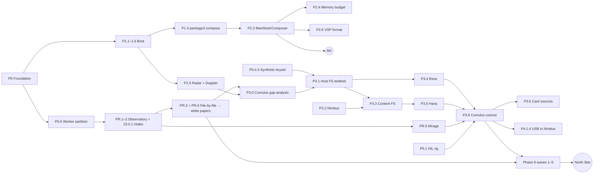

# Verdant — Execution Plan

> **Status:** Draft v0.5 · 2026-10-20 · derived from [`seed.md`](seed.md)
> **Name:** **Verdant** (formerly Skyline). One word, never "Verdant OS". Releases are editions named `Verdant <major>.<minor> '<codename>'`, starting with **Verdant 1.0 'moss'** (ADR-014, LEXICON §1).
> **Reference firmware:** Horizon **23.0.1**, the single version Verdant is built to match (ADR-004).
> **Upstream baseline:** Atmosphère 1.12.1 (released 2026-10-16; its tree targets HOS 23.0.1) · hekate (active) · libnx (active)
> **Mantra:** *clean-room recompilation*. Observers decompile and recompile Horizon to study and test it. Builders write Verdant anew from plain-language white papers. Reuse what already exists, fill only the real gaps, and **never ship Nintendo's code** (§1 Rule 0).
> **Terminology:** [`LEXICON.md`](LEXICON.md) is the single source of truth for names and terms. Every agent reads it first.
> **End state:** an open replacement for Horizon that matches what Nintendo's OS can do, maintained by the community after Nintendo stops.

---

## 0. How to read this plan

- **Outline:** Phase → **Epic** (major slice, a demonstrable or shippable unit) → **Task** (minor slice, from one PR to a handful).
- **IDs:** `P3.5.2` means Phase 3, Epic 5, Task 2. `PR.x` is Phase R (research). Use these IDs in branches, commits, PRs and issues.
- **Strategy tags** on every epic:
  - `REUSE`: take upstream as-is (vendored, pinned, unmodified).
  - `ADAPT`: upstream exists; we configure, patch or extend it, and send patches upstream first.
  - `BUILD`: a real gap; new work.
  - `SPIKE`: time-boxed research that ends in a written decision (ADR), not shipped code.
- **Worker class** on every epic. It decides which kind of agent may take the work (§1, P0.6):
  - `observer`: touches Nintendo files; outputs only white papers or scores.
  - `builder`: writes Verdant code, tests, tools or docs; never touches Nintendo files.
  - `general`: governance or legal work that touches neither.
  - `mixed`: individual tasks are tagged **[observer]**; untagged tasks in a mixed epic are builder tasks.
- **Effort:** `S` = days · `M` = weeks · `L` = 1–3 months · `XL` = a quarter or more.
- **Exit:** every phase and epic has an observable condition that closes it.
- **Phase numbers are thematic and match the seed. They are not a strict order.** Execution order is in §5.
- **Additions to the seed:** Phase 0 (foundation), Phase R (research, which runs alongside everything) and Phase 6 (full Horizon replacement, the endgame).

---

## 1. The Mantra: Clean-Room Recompilation

**Goal:** meet Horizon 23.0.1 **by metric and by behavior, under every condition**, so Verdant is identical to it in almost every way, but written new and free of the rights that bind Nintendo's code. Users keep running native games, keep getting security fixes after Nintendo stops, can build new hardware mods, and own their console down to the lowest software layer.

In Verdant, *clean-room recompilation* means: **observers** decompile and recompile Horizon to study and test it, and **builders** write Verdant clean of its code.

### Rule 0: never ship Nintendo's code

> **Nothing derived from Nintendo's code is ever committed to any Verdant codebase or distributed in any form.** That covers firmware, binaries, keys, decompiled or disassembled code, lifted IR, recompiled binaries, analysis databases, byte sequences copied from Nintendo binaries (including search patterns), and every other artifact of their code. Decompilation and recompilation exist **for research and testing only**.

### Method: partitioned workers

Workers are mostly AI agents, split into two classes that never share context. Observers "peek at the answers" as much as they need, and spell them out in plain language. Builders write the code from what the observers wrote, without ever seeing the originals. Research runs at full speed, and the code stays clean.

| | **Observers** (research agents) | **Builders** (implementing agents) |
|---|---|---|
| **Work** | Decryption, file-by-file analysis, decompilation, debugging against the original, static recompilation (Mirage), oracle test suites, parity and independence measurement | Verdant code, public tests, tools, build and release, docs |
| **May read** | The Observatory (23.0.1 firmware and keys from contributors' own consoles, Ghidra databases, Mirage, Radar traces), the public repo, public references | The public repo (code, merged white papers, LEXICON), vendored upstream, public references. **Never the Observatory.** |
| **May write** | The Observatory. In the public repo: `whitepapers/**` and LEXICON proposals **only** | Public-repo code, test, tool and doc paths. **Never** `whitepapers/**` |
| **Crosses the boundary** | White papers (plain English or 简体中文, no code), parity and independence scores | Anything may flow back to observers (code, questions, results) |

Humans who contribute follow the same partition. Each human picks a class per component, and someone who has read Observatory material about a component does not write its code (P0.6.8).

**Legal footing (to be confirmed by counsel in P0.1.4):**
- **The builder side is a clean room in the strict legal sense.** The workers that write Verdant's code never see Nintendo's code, only white papers.
- **The observer side relies on intermediate copying for interoperability.** Courts accepted this in *Sega v. Accolade* (1992) and *Sony v. Connectix* (2000), and EU Software Directive Art. 6 permits it. Nothing the Observatory holds is ever distributed.
- **Independence checks (PR.8) stay as a second line of defense.** A partition can be breached, for example by a white paper that slips into code-like detail. A model can also reproduce code it memorized during training.

### Rules

0. **Never ship Nintendo's code** (above).
1. **Reuse before build.** Before a `BUILD` task starts, its owner checks Appendix A and the Replacement Ledger (P0.5.3) and writes down why `REUSE`/`ADAPT` is not enough.
2. **Upstream-first.** Generic fixes go to Atmosphère, hekate, libnx and the rest. Our patch queue is a holding area, not a fork.
3. **Partition workers.** Observers and builders are separate classes with separate sandboxes, credentials and memory (P0.6). Only white papers and scores cross from observers to builders.
4. **Contain research artifacts.** Everything Nintendo-derived lives only in the Observatory (PR.1): encrypted, access-controlled, never mirrored, never inside a checkout of a Verdant repo.
5. **White papers, not code.**
   - **Language:** plain English or Standard Chinese (简体中文), using LEXICON terms. Codenames are never translated.
   - **May contain:** interfaces and command IDs; data layouts as tables (offset, size, meaning); constants needed for interoperability; file and wire formats; result codes; state machines (prose or `mermaid` diagrams); algorithms as numbered prose steps; ordering, timing and error behavior; acceptance criteria; test vectors as tables made with the synthetic keyset.
   - **May not contain:** code or pseudocode in any language; decompiler output; transliterations; Nintendo strings or data tables beyond interoperability facts; keys.
   - Every white paper passes lint (PR.6.3) and boundary review (PR.6.4).
6. **Match behavior, not shape.** Builders write in Verdant's (and libstratosphere's) own architecture and LEXICON naming. Interface facts are reproduced exactly, because they are function, not expression. Every non-obvious constant cites its white paper.
7. **Prove independence.** Every BUILD module passes the independence checks (PR.8) before it ships. Builder PRs carry a DCO sign-off and an attestation that the code was written from white papers and public sources.
8. **No leaked material, anywhere.** Leaked Nintendo source, SDKs or internal documents are banned even in the Observatory. One use would taint every component it touched.
9. **User-sourced at runtime.** Proprietary pieces that are still needed (irreducible hardware firmware per ADR-010, and Horizon modules not yet replaced) are read on-device from the user's own console. Verdant never carries them.
10. **Reproducible.** Releases are bit-for-bit reproducible and ship with an SBOM and provenance attestation.
11. **License boundary.** Verdant's core is GPL-2.0-only, inherited from Atmosphère and hekate. GPL-3.0 components (JKSV, Goldleaf, sys-con, nxdumptool, switch-lan-play) ship only as **separate programs** and are never linked into GPL-2.0-only binaries. MIT, ISC and BSD code may be incorporated with attribution.
12. **Piracy is out of scope, in both directions.** Verdant ships no piracy features (signature patches, ticket bypasses, key or title-key distribution, content distribution). It also adds no DRM or anti-piracy enforcement beyond faithfully reproducing Horizon's own behavior. The console's security was broken long ago; Verdant uses the existing boot exploits to run, and otherwise steps around the question. Its goal is software independence at the lowest level.

### What "identical" means: parity dimensions

A Verdant module meets Horizon only when it matches 23.0.1 on every dimension below. PR.7 measures this. The only allowed departures are documented **security deviations** (PR.7.7).

| Dimension | Matches when… |
|---|---|
| **Functional** | Every IPC command returns the same outputs for the same inputs |
| **Error** | Every failure condition produces the same result code, at the same point in the sequence |
| **State** | State machines make the same transitions; events and notifications fire in the same order |
| **Persistent formats** | On-disk and wire data (saves, settings, databases, caches) are bit-identical, so switching between Verdant and stock Horizon loses nothing |
| **Resource** | Memory footprint, handle, session, thread and limit behavior stay within Horizon's envelope |
| **Timing** | Latency and throughput stay within agreed envelopes of Horizon's, including ordering under concurrency |
| **Conditions** | All of the above also hold under fault injection: storage full, card pulled, SD removed, corrupt data, power loss, sleep mid-operation, low battery |

---

## 2. Baseline: What Already Exists

Checked on 2026-10-20 against the GitHub API and the Atmosphère `master` tree. **Most of seed Phases 1–2 is already delivered upstream.** The real gaps are Cumulus (the file system service, including Rime and Hana), distribution and composition, hardware-extension modules, post-EOL services, test infrastructure, and eventually every other Horizon module (Phase 6).

| Seed item | Upstream state today | Verdant stance |
|---|---|---|
| Stage-1 bootloader (Hekate/Nyx) | hekate is active and boots Atmosphère's `package3` via `fss0=` | `REUSE` |
| RCM / chip payloads | `t210`: Fusée Gelée bootrom bug (unpatchable) via TegraRcmGUI, web launchers or NXLoader. `t210b01`: modchips (Picofly, open firmware) | `REUSE` + docs |
| DRAM, clock and PMIC init | Done by hekate's BDK and fusee, with per-board SDRAM tables | `REUSE`. Audit only, no new register code |
| TrustZone / secure monitor | Exosphère | `REUSE` |
| Microkernel | Mesosphère, default since Atmosphère 1.0, tracking HOS 23.0.1. Board targets: `nintendo/nx`, `nintendo/nx_bpmp`, **`qemu/virt`** | `REUSE` |
| `svc` wrappers | libnx (ISC) plus libvapours/libstratosphere | `REUSE` |
| HIPC (CMIF) / TIPC | libstratosphere `sf`: server, client, domains, mitm | `REUSE` |
| sm, pm, loader, spl, ncm, boot, boot2, ro, fatal, creport, erpt, pgl, dmnt(.gen2), htc, jpegdec, LogManager, cs, memlet | Stratosphère reimplementations | `REUSE` |
| **File system service (Cumulus)** | **Gap.** `stratosphere/fs` is only a skeleton (`fs_main.cpp` initializes `fssystem` and nothing else). Library support is large: `fssystem` (NCA reader/driver, AES-CTR/XTS, BucketTree, Indirect/Sparse storage, integrity, PFS, RomFS), `fssrv` (proxy impl, access control, program registry), `gc/impl` (game card crypto, embedded data holder) and libvapours `sdmmc` (SD, MMC, **game card ASIC**). **Save data FS exists only as interface headers.** | `ADAPT` libs, `BUILD` service, Rime and Hana |
| emuMMC | `m4xw/emuMMC`, patched into Nintendo's FS | `REUSE` until Cumulus lands |
| SE crypto and key derivation | Exosphère keyslots plus spl. FS loads keys through spl | `REUSE` |
| Other HOS sysmodules (ns, am, hid, nvservices, vi, audio, bluetooth, btm, wlan, nifm, bsdsocket, account, ptm/tc/pcv, usb, settings, es, …) | Nintendo binaries loaded from the user's NAND. Some are extended by `ams_mitm` (bpc, dns, fs, ns, set, pm, sysupdater) | User-sourced now; replaced wave by wave in Phase 6 |
| Fan control | `boot` already enables the fan. sys-clk (custom license), NX-FanControl (MIT), Switch-OC-Suite (custom license) | `ADAPT`/`BUILD` (Gale) |
| Controllers | MissionControl (GPL-2.0, Bluetooth). sys-con (GPL-3.0, USB, separate process) | `REUSE` |
| USB mass storage | libusbhsfs (GPL-2.0) | `ADAPT` |
| LAN multiplayer | ldn_mitm (GPL-2.0). switch-lan-play (GPL-3.0) | `REUSE` |
| DNS redirection | Atmosphère `dns.mitm` (handles the 23.0.x c-ares `sfdnsres` commands) | `REUSE` |
| Test suites | Atmosphère `tests/`: TestFs, TestOsEvents, TestSocket, TestStack, TestSvc. libstratosphere builds on **Linux, macOS and Windows hosts** | `REUSE` + extend |
| Behavioral knowledge of Horizon | SwitchBrew, Atmosphère's reimplementations, emulator HLE services (Ryujinx forks, MIT; yuzu forks, GPL-3.0) | Public references for both classes; observers fill the gaps by decompiling 23.0.1 |

**Hard constraint:** Atmosphère 1.12.1 says about **40 MB** of applet-pool memory is left for custom sysmodules after its 23.0.x browser-applet patches. Every *additive* Verdant module spends from that pool. A *replacement* module spends the budget of the module it replaces. See P2.4.

---

## 3. Architecture Decisions to Ratify (ADRs)

| ADR | Decision (proposed) |
|---|---|
| ADR-001 | Verdant is a **distribution layered on Atmosphère** (vendored, pinned, upstream-first patch queue). It is not a hard fork. |
| ADR-002 | **Strangler-fig path to full replacement.** Boot with user-sourced HOS sysmodules, then replace services one at a time behind identical IPC interfaces. Each replacement can be reverted on its own. **End state: no Nintendo software process is needed to boot and play a game** (Phase 6). Only irreducible hardware firmware remains (ADR-010). |
| ADR-003 | **emuMMC-first and brick-safe.** Verdant runs from emuMMC by default and sysMMC stays stock. Nothing writes BOOT0/BOOT1/PRODINFO without an explicit, backed-up user action. Fuses are never burned. |
| ADR-004 | **One reference firmware: Horizon 23.0.1.** All research, white papers, parity targets and Verdant code are centered on 23.0.1. Users keep their emuMMC on 23.0.1. Moving to a newer release is an explicit re-baselining decision, informed by a diff report (PR.4.2), and never automatic. Any other version is supported only through a VSP (ADR-012). |
| ADR-005 | **License boundary** (§1 rule 11). Core is GPL-2.0-only. GPL-3.0 code runs only as separate processes. |
| ADR-006 | **Target matrix.** Tier 1: `t210` (HAC-001), `t210b01` (HAC-001-01). Tier 2: HDH-001 (Lite), HEG-001 (OLED). Tier 3 (research): non-Nintendo T210 boards (Jetson TX1/Nano) and QEMU `virt`. |
| ADR-007 | **Memory budget policy.** Each module declares a budget; composition fails if the total exceeds the pool (P2.4). |
| ADR-008 | **Piracy neutrality** (§1 rule 12). No piracy features, no added anti-piracy enforcement, faithful reproduction of Horizon's ES and ticket behavior. |
| ADR-009 | **Partitioned workers and the white-paper channel** (§1 rules 3–8). Observers and builders are separate agent classes with enforced isolation (P0.6). Only white papers and scores cross. Independence checks (PR.8) are the second line of defense. |
| ADR-010 | **Irreducible firmware.** Code that runs on other processors and is signature-checked by hardware we cannot change stays user-sourced permanently. Candidates (confirm each in PR.2.5): bootrom (in silicon), TSEC firmware, GPU falcon microcode, Hana firmware, Broadcom Wi-Fi/BT firmware, controller firmware, and the signed boot pieces specific to `t210b01`. |
| ADR-011 | **Static recompilation is for research and testing only.** Mirage builds serve as test oracles and as targets for instrumentation and fuzzing, inside the Observatory. They are never committed, never distributed, and never offered as a user-facing tool, not even one that recompiles the user's own firmware. |
| ADR-012 | **Version support patches (VSPs).** Verdant supports 23.0.1. Anyone who wants another version, especially a much older one, runs the same process for that version themselves: their own firmware and keys, their own Observatory, their own observers and builders. Those sensitive files are theirs to handle and never touch the project. A VSP contains only Verdant-authored material: white-paper deltas, a source patch series, build-ID-keyed offsets with Verdant-authored bytes, and scores. It contains **no Nintendo bytes, not even search patterns**. The project reviews VSPs for compliance only, not maintenance (P2.6). |
| ADR-013 | **Naming and terminology.** [`LEXICON.md`](LEXICON.md) is the single source of truth. Verdant components get codenames by theme. Nintendo-internal names (for example "Lotus" → **Hana**) never appear in Verdant identifiers. Literal interoperability identifiers stay byte-exact. |
| ADR-014 | **Name and editions.** The project is **Verdant**: one word, with no "OS" or "Project" around it. Each major release is an edition with a lowercase green-plant codename (never a flower, since flowers are for hardware), written `Verdant 1.0 'moss'`. Minor and patch releases keep their major's codename. Codenames grow in size and lifespan from edition to edition; **yew** is reserved for the North Star edition. The list and rules live in LEXICON §1. |

---

## 4. Phased Plan

### Phase 0: Foundation, Governance & Worker Partition *(new; prerequisite for everything else)*

**Goal:** the repo, rules, toolchain, CI and worker partition exist, so every later artifact is reproducible, provenance-clean, and produced by the right class of worker.
**Exit:** tag `v0.0.1` reproducibly builds stock Atmosphère and hekate from pinned sources in CI, emits an SBOM and provenance, and passes the leak guards. Observer and builder agents run in enforced, separate sandboxes.

#### P0.1 Governance & legal (`BUILD` · S · general)
- [ ] **P0.1.1** Ratify §1 (Rule 0, the partition, rules 1–12, parity dimensions) in `CLEANROOM.md`.
- [ ] **P0.1.2** Write `CONTRIBUTING.md`: the worker classes and how humans pick a class per component; DCO sign-off; PR templates per class (builder: "written from white papers and public sources" attestation plus independence-check status; observer: white-paper boundary checklist).
- [ ] **P0.1.3** Licensing: GPL-2.0-only project license, a `LICENSES/` directory and SPDX headers (REUSE-spec compliant).
- [ ] **P0.1.4** Legal memo, reviewed by counsel. It covers:
  - decompilation and intermediate copying for interoperability (*Sega v. Accolade*, *Sony v. Connectix*, EU Software Directive Art. 6, DMCA §1201(f));
  - the agent partition as clean-room evidence, and which records to keep (P0.6.7);
  - the copyright status of agent-written code and what that means for GPL licensing and enforcement;
  - whether contributors may share firmware copies inside the Observatory;
  - the static recompilation boundary (ADR-011) and what a VSP may contain (ADR-012);
  - backup-copy law per jurisdiction, trademark use in branding, and what users may and may not do;
  - lessons from the 2024 yuzu and Ryujinx takedowns.
- [ ] **P0.1.5** Write ADR-001…014 in `docs/adr/`.
- [ ] **P0.1.6** Add `CODE_OF_CONDUCT.md` and `SECURITY.md` with a private disclosure channel.

#### P0.2 Repository layout & upstream vendoring (`ADAPT` · M · builder)
- [ ] **P0.2.1** Create the monorepo layout. The Observatory is a separate private store and is **never** a directory here.
  ```
  upstream/      pinned vendored sources (atmosphere, hekate, libnx, emummc, …); read-only, git subtree
  patches/       upstream patch queues, one directory per upstream, each patch tagged "upstreamable: y/n"
  whitepapers/   observer output: plain-language white papers, one directory per analyzed module (PR.6)
  sysmodules/    builder code: one directory per Verdant codename, each with a verdant.toml manifest
  libs/          libverdant (shared helpers on top of libstratosphere)
  boot/          package3 composition, hekate ini profiles
  tools/         host tools: installer, composer, vsp, upstream-sync, fixture builder
  tests/         unit/, host/, device/, hil/, written by builders from white-paper acceptance criteria
  vsp/           version support patches (P2.6)
  docs/          user + developer docs, ADRs, ledger, design/ (Verdant's own designs, by builders)
  LEXICON.md     names and terms (ADR-013)
  ```
- [ ] **P0.2.2** `tools/upstream-sync`: bump an upstream to a tag, reapply its patch queue, report conflicts and stale patches.
- [ ] **P0.2.3** Pin the baseline: Atmosphère 1.12.1 (targets 23.0.1), the latest hekate tag, and the libnx revision Atmosphère builds against.
- [ ] **P0.2.4** Scheduled job that detects new upstream tags and opens a sync PR.

#### P0.3 Toolchain & reproducible builds (`ADAPT` · M · builder)
- [ ] **P0.3.1** Containerized toolchain: devkitPro `devkita64`/`devkitarm` images pinned by digest, plus host dependencies.
- [ ] **P0.3.2** Top-level build orchestrator (Make or `just`) that produces the hekate payload, Verdant `package3`, sysmodule NSPs/KIPs and an SD-card layout archive.
- [ ] **P0.3.3** Reproducibility: `SOURCE_DATE_EPOCH`, `-ffile-prefix-map`, deterministic archives. A CI job builds twice and diffs the outputs.
- [ ] **P0.3.4** SBOM (SPDX or CycloneDX) and SLSA/in-toto provenance for every release.
- [ ] **P0.3.5** Sign release archives (minisign or sigstore). The installer checks these signatures (P1.6.1).

#### P0.4 Provenance & leak guards (`BUILD` · S · builder)
- [ ] **P0.4.1** `PROVENANCE.md` plus machine-readable `provenance.toml`, recording origin URL, commit, license and local patches for every component.
- [ ] **P0.4.2** CI leak guard that rejects:
  - key-file patterns (named 128-bit hex entries, `*.keys`);
  - Nintendo container magics (`NCA3`, `PFS0`, `HFS0`, `KIP1`, `NSO0`, …) outside approved fixture paths;
  - firmware file names, and binary blobs above a size threshold;
  - **decompiler fingerprints:** Ghidra-style names (`FUN_`, `DAT_`, `LAB_`, `param_N`, `local_NN`, `uVarN`, `undefined8`), IDA-style names (`sub_`, `loc_`, `LODWORD`, `__int64`, `vN =`), and Ghidra/IDA project files;
  - **LEXICON deny-list names** in Verdant identifiers and file names (outside `upstream/`).
- [ ] **P0.4.3** CI license gate: SPDX scan that flags any GPL-3.0 code linked into a GPL-2.0-only target.
- [ ] **P0.4.4** **Synthetic test keyset.** Generate a random, clearly labelled *Verdant Test Keyset* and a fixture builder that produces NCAs, XCIs, PFS0/HFS0, RomFS and save images encrypted with it. This lets builder CI exercise every crypto and FS path without Nintendo keys.

#### P0.5 Knowledge base (`BUILD` · S, then ongoing · builder)
- [x] **P0.5.1** Seed [`LEXICON.md`](LEXICON.md): the project name and edition codenames, naming themes, roles, codenames, hardware terms, literal identifiers, deny list, and the change process. *(Done in v0.4.)* Keep it current: every new term arrives by PR before first use.
- [ ] **P0.5.2** Index of public references per subsystem (SwitchBrew, Atmosphère docs, LibHac, hactool, nstool), usable by both classes.
- [ ] **P0.5.3** **Sysmodule Replacement Ledger** (`docs/ledger.md`): every HOS title ID with its Verdant codename, status (`open-upstream` / `mitm-extended` / `user-sourced` / `planned` / `out-of-scope`), white-paper coverage, owner, memory budget, priority and rationale. Seed it from §2.

#### P0.6 Worker partition & enforcement (`BUILD` · M · builder)
*How the clean room is enforced in practice: by permissions, not by trust.*
- [ ] **P0.6.1** Agent definitions with tools, permissions, standing instructions (read LEXICON first; class rules from §1) and output channels:
  - **observer**;
  - **boundary reviewer** (observer-side, PR.6.4);
  - **independence checker** (observer-side, PR.8);
  - **builder**.
- [ ] **P0.6.2** Sandboxes:
  - observers run inside Observatory environments with firmware, keys, Ghidra, Mirage and Radar traces;
  - builders run in environments with no route, mount, credential or token that reaches the Observatory.
- [ ] **P0.6.3** Separate commit identities per class, enforced in CI:
  - observer commits may touch only `whitepapers/**` and `LEXICON.md`;
  - builder commits may never touch `whitepapers/**`.
- [ ] **P0.6.4** No shared state across classes: separate memory stores, caches, scratchpads, vector indexes and conversation threads. Builder sessions start from a clean context of the repo, **merged** white papers and LEXICON only. They never see drafts.
- [ ] **P0.6.5** Review channel: observers do not suggest code on builder PRs. Their feedback goes through white-paper updates or errata (PR.6.5), and a bot flags any observer comment on a code PR.
- [ ] **P0.6.6** Task routing: tracker labels `class:observer` / `class:builder` mirror this plan's tags, and the dispatcher only gives a task to an agent of the matching class.
- [ ] **P0.6.7** Audit trail: session logs, tool-call logs and access logs for every agent run, kept privately as evidence for the clean-room record.
- [ ] **P0.6.8** Human contributors: a register records each human's class per component. A human who has read Observatory material on a component does not write that component's code.

---

### Phase R: Research Pipeline (the Observatory) *(new; runs alongside every phase from Phase 0 onward)*

**Goal:** know Horizon 23.0.1 well enough to match it under every condition. Work through it file by file, and spell what we learn out in plain-language white papers for builders.
**Exit (initial):** every file in 23.0.1 decrypted and catalogued; IPC tables extracted; the first white-paper sets (Cumulus interfaces, Almanac, Dusk) merged through boundary review; Mirage evaluated.
**Exit (ongoing):** white-paper coverage on the ledger stays ahead of what builders need for Phase 3 and Phase 6.

#### PR.1 The Observatory (`BUILD` · S · observer)
- [ ] **PR.1.1** Private research workspace: separate org, repo and storage with access control and encryption at rest, never mirrored to the public project. It holds firmware, keys, analysis databases, decompiled output, Mirage builds, Radar traces and the private research CI.
- [ ] **PR.1.2** Acquisition: firmware 23.0.1 and keys come from contributors' own consoles (a NAND backup or the update installed on their own console; keys via Lockpick_RCM). Whether copies may be shared inside the Observatory follows the counsel memo (P0.1.4).
- [ ] **PR.1.3** Containment (§1 rule 4): research artifacts stay in dedicated research environments. The only Verdant path observers write to is `whitepapers/`, and pre-commit hooks plus CI reject Observatory paths, project files and decompiler fingerprints (P0.4.2).
- [ ] **PR.1.4** Onboarding (agent instructions and a human guide): Rule 0, white-paper rules, the leaked-material ban, and how to use LEXICON.

#### PR.2 Firmware intake: 23.0.1 (`ADAPT` · M · observer)
- [ ] **PR.2.1** Decrypt and extract with hactool (ISC) or nstool (MIT) and the contributor's own keys: package1; package2 (kernel and INI1 KIPs); every system title (program NCAs → NSO, NPDM and RomFS; system data archives; applets).
- [ ] **PR.2.2** **File catalog**, the file-by-file work list: every file with title ID, module name, version, build ID, hashes, Verdant codename (from LEXICON, or "unassigned"), owner and status. The catalog stays in the Observatory; the ledger (P0.5.3) shows public status only.
- [ ] **PR.2.3** Headless Ghidra (Apache-2.0) import of every executable with Ghidra-Switch-Loader (ISC), followed by scripted auto-analysis.
- [ ] **PR.2.4** Clean type libraries: build Ghidra data types from **our own** headers (libstratosphere, libnx), so typing the decompilation never depends on leaked material.
- [ ] **PR.2.5** Hardware-firmware inventory: identify every blob that runs off the main CPU and confirm whether hardware enforces its signature (feeds ADR-010).

#### PR.3 File-by-file analysis (`BUILD` · L, then ongoing · observer)
- [ ] **PR.3.1** Work order follows the plan:
  1. Cumulus first: the FS KIP, covering Nimbus, Rime and Hana.
  2. Then Phase 6 Wave 1: settings → Almanac; psc, spsm and bpc → Dusk; pcv, ptm and tc → Gale; bus services → Jetstream; usb → Kite.
  3. Then later waves.
- [ ] **PR.3.2** IPC table extraction: scripts that find the CMIF and TIPC dispatch metadata in each module and produce interface tables for white papers.
- [ ] **PR.3.3** Shared-library recognition: a Ghidra BSim / Function ID database for the Horizon library code linked into every module, so each library function is analyzed once and labelled automatically everywhere.
- [ ] **PR.3.4** Atmosphère cross-map: find what upstream already reimplements, so white papers can point builders to existing open code instead of re-describing it.
- [ ] **PR.3.5** Per-file status pipeline: catalogued → analyzed → white papers drafted → boundary-reviewed → merged → implemented → parity-verified. Coverage metrics per file feed the ledger.

#### PR.4 Version diffing (`ADAPT` · M · observer)
- [ ] **PR.4.1** Diff tooling: BinDiff (Apache-2.0) and/or Diaphora (AGPL-3.0, used as a tool only) to diff two firmware versions module by module and carry names and types forward.
- [ ] **PR.4.2** Re-baselining input: when Nintendo ships a newer release, produce a diff report (new and removed IPC commands, changed handlers, new modules, struct size changes, new result codes) for the ADR-004 decision.
- [ ] **PR.4.3** VSP author kit: the same tooling and process, documented for VSP authors who run their own Observatory against their own version (P2.6). Verdant itself does not analyze non-reference versions.
- [ ] **PR.4.4** Security triage of newer releases: when a Nintendo fix also applies to 23.0.1 behavior, open a private ticket, check Verdant modules for the same bug class, and record a security deviation where needed (PR.7.7).

#### PR.5 Mirage: static recompilation lab (`SPIKE` → `BUILD` · L · observer)
*An instrument for understanding and testing Horizon, never a shipping path (ADR-011).*
- [ ] **PR.5.1** Evaluate AArch64 lifters for NSO → LLVM IR or C: Remill (Apache-2.0), rev.ng (GPL-2.0), RetDec (MIT) and Ghidra P-code. Design references are N64Recomp and XenonRecomp (MIT). Criteria: correctness on Horizon code (exclusive monitors, TLS, SIMD, jump tables, C++ runtime) and how much can be automated.
- [ ] **PR.5.2** Host runtime shim: run a Mirage module as a host process, with `svc` calls and IPC served by libstratosphere's Linux/macOS host build, so it can be called exactly like a Verdant module.
- [ ] **PR.5.3** **Mirage as oracle:** connect Mirage modules to Doppler (P2.5.4). The same request sequences run against the original and the Verdant module on a host, at CI speed, with no console. This runs only in the Observatory.
- [ ] **PR.5.4** Instrument and fuzz the originals: coverage tracing to answer questions decompilation leaves open, and fuzzing to find vulnerabilities that need post-EOL mitigation (feeds P5.4).
- [ ] **PR.5.5** Go/no-go per module. Self-contained modules (settings, FS) may be oracle-ready early; hardware-bound ones (nvservices) may never be.
- [ ] **PR.5.6** **Private research CI:** nightly runs of Verdant candidate builds against Mirage oracles and against 23.0.1 on HIL rigs. It publishes only parity scores (PR.7) and independence scores (PR.8).

#### PR.6 White papers (`BUILD` · ongoing · observer)
- [ ] **PR.6.1** Templates and types. Every type includes acceptance criteria and test vectors:
  - **module overview**: file identity (title ID, module name, 23.0.1, build ID), role, interfaces, dependencies;
  - **component paper**;
  - **format paper**;
  - **protocol / state-machine paper**;
  - **erratum**;
  - **delta**: for re-baselining, or inside a VSP.
- [ ] **PR.6.2** Layout: `whitepapers/<codename>/00-overview.md`, then `NN-<topic>.md`. Write in plain English or 简体中文 with LEXICON terms. A term missing from LEXICON is added there first.
- [ ] **PR.6.3** White-paper lint in CI:
  - no fenced code blocks except `mermaid`;
  - no decompiler fingerprints;
  - no hex runs over N bytes outside layout and constant tables;
  - no deny-listed names;
  - required sections present.
- [ ] **PR.6.4** Boundary review: a second observer, who can compare against the Observatory, checks every white paper against Rule 0 and §1 rule 5 before merge.
- [ ] **PR.6.5** Questions and errata: builders ask questions in the tracker (builder → observer is unrestricted), and observers answer with white-paper updates or errata, never code. Parity failures (PR.7) also come back to builders as errata.
- [ ] **PR.6.6** Secondary references: emulator HLE services (Ryujinx forks, yuzu forks), SwitchBrew and LibHac help observers cross-check. Because white papers contain no code, these sources' licenses never reach Verdant through them.

#### PR.7 Parity: by metric and by behavior (`BUILD` · M · observer)
*Turns "identical in almost every way" into numbers across the §1 parity dimensions, against 23.0.1.*
- [ ] **PR.7.1** Parity suites: from each white paper's acceptance criteria and test vectors, generate Observatory-side suites (every command × input class × failure condition) and run them against Mirage (PR.5.3) and real 23.0.1 hardware (P2.5.4). Builders write the public tests from the same criteria.
- [ ] **PR.7.2** Persistent-format round trips: data written by Verdant must be read correctly by stock Horizon and the reverse (saves, settings, databases, caches), with bit-identical output wherever Horizon's own output is deterministic.
- [ ] **PR.7.3** Timing and resource envelopes: measure Horizon's latency, throughput, memory and handle usage per command, then set an accepted envelope per module.
- [ ] **PR.7.4** Fault-injection matrix for the "every condition" dimension: storage full, card pulled, SD removed, corrupt data, power loss (HIL relay), sleep mid-operation, low battery.
- [ ] **PR.7.5** Parity score per module and per dimension, published by the private research CI (PR.5.6). Phase 6 promotion thresholds are set against it.
- [ ] **PR.7.6** Feed parity into the ledger (P0.5.3).
- [ ] **PR.7.7** Security deviation register: deliberate, documented departures from 23.0.1 behavior where it is vulnerable, excluded from parity scoring.

#### PR.8 Independence checks: proving the code is ours (`BUILD` · M · observer)
*The second line of defense behind the partition. It needs Nintendo's binaries, so it runs in the Observatory, and only scores leave.*
- [ ] **PR.8.1** Binary similarity scan: compile each Verdant module and compare it function by function against the matching 23.0.1 module (BinDiff and BSim). Non-trivial functions above a similarity threshold go to review. A size floor excludes small functions that the interface forces into one shape.
- [ ] **PR.8.2** Nintendo-byte scan: search every Verdant repo, VSP and release artifact for byte runs of N or more bytes that also occur in a Horizon binary, excluding interoperability constants listed in white papers.
- [ ] **PR.8.3** Source review checklist for builder PRs, applied by builder-side reviewers: no decompiler idioms (stray temporaries, goto ladders, cast chains, offset arithmetic in place of named fields), Verdant-native structure, LEXICON naming, and a white-paper reference for every non-obvious constant.
- [ ] **PR.8.4** Remediation runbook: flagged code is discarded and rewritten from the white paper by a fresh builder session. If the white paper caused the problem, fix the white paper first (erratum). Record every incident.
- [ ] **PR.8.5** Publish an independence report with each release: per-module scores and the number of reviewed or remediated functions. Counsel signs off the thresholds (P0.1.4).

---

### Phase 1: Foundation & Bootchain Bootstrapping

**Goal (seed):** a reliable custom boot pipeline from cold boot to the execution environment.
**Exit:** on Tier-1 hardware, cold boot → hekate → Verdant `package3` → HOS home menu on a 23.0.1 emuMMC succeeds 100 times in a row on the HIL rig, and backups are enforced before the first boot.

#### P1.1 Payload delivery (`REUSE` · S · builder)
- [ ] **P1.1.1** `t210` RCM: document and package the injection paths (TegraRcmGUI, web launchers, NXLoader, RCM jig and dongle). No new code.
- [ ] **P1.1.2** `t210b01`: document the modchip path (Picofly open firmware → sdloader → hekate), with a support matrix and safety notes. Verdant sells and endorses no hardware.
- [ ] **P1.1.3** Payload-chain ADR: hekate is stage 1 (per the seed), with a direct `fusee` boot as a fallback. Define the autoboot policy.

#### P1.2 Hekate integration (`ADAPT` · M · builder)
- [ ] **P1.2.1** Verdant boot entries in `hekate_ipl.ini`: `fss0=` pointing at the Verdant `package3`, emuMMC forced, plus A/B slot entries (see P1.6.2).
- [ ] **P1.2.2** Nyx theme and launch entry for Verdant. Otherwise keep upstream defaults.
- [ ] **P1.2.3** Backup gate: refuse the first Verdant boot until a NAND + BOOT0/1 + PRODINFO backup exists (hekate already provides the tooling; we add the check).
- [ ] **P1.2.4** Keep hekate changes as a patch queue and upstream the generic ones.

#### P1.3 Hardware init audit (seed: memory controllers, clocks, power rails) (`REUSE` + `SPIKE` · S · builder)
- [ ] **P1.3.1** Confirm from upstream source that hekate BDK and fusee cover SDRAM training (every DRAM vendor and board revision), PLLs and clock trees, and PMIC rails (MAX77620, plus MAX77812 on `t210b01`) for every Tier-1/2 model. Write `docs/design/bringup.md` listing who initializes what, and in which boot stage.
- [ ] **P1.3.2** List anything Verdant needs that the bootloader does not do. Expected: nothing for stock clocks. Overclock tables are deferred to Gale (P4.3).
- [ ] **P1.3.3** Policy: Verdant adds no register-level init outside upstream-maintained code unless an ADR justifies it.

#### P1.4 Exosphère & `package3` composition (`ADAPT` · M · builder)
- [ ] **P1.4.1** Build Atmosphère's `package3` (Exosphère + Mesosphère + Stratosphère KIPs) from vendored sources, unmodified, and check it against the official release (hash-equivalent where reproducible).
- [ ] **P1.4.2** `boot/compose`: assemble `package3` variants from a manifest of Verdant-selected KIPs. Exosphère and Mesosphère stay untouched.
- [ ] **P1.4.3** Default `exosphere.ini`: decide `blank_prodinfo_emummc` (reduces online-ban exposure), `allow_writing_to_cal_sysmmc=0`, and log port settings.
- [ ] **P1.4.4** Verification only: SE keyslot and TSEC/package1 flows on `t210` and `t210b01`.

#### P1.5 emuMMC & SD layout (`REUSE` · S · builder)
- [ ] **P1.5.1** Recommend partition-based emuMMC (made by hekate) for performance; keep file-based emuMMC supported. Document keeping emuMMC on 23.0.1 (installed through Daybreak from the user's own update package).
- [ ] **P1.5.2** SD tree: `/verdant/` holds config and slots; keep `/atmosphere/contents/` so the existing homebrew ecosystem keeps working.

#### P1.6 Installer, updater & rollback (`BUILD` · M · builder)
- [ ] **P1.6.1** Cross-platform host installer (CLI first): check the release signature, lay out the SD card, check that backups exist, write configs. It never handles keys or firmware.
- [ ] **P1.6.2** A/B profiles (`/verdant/slots/{a,b}`) with a boot counter. After N failed boots, fall back to the last known-good slot.
- [ ] **P1.6.3** Firmware check: the installer and the boot path refuse Verdant modules when the emuMMC firmware is not 23.0.1 and no matching VSP is installed, and fall back to the stock Atmosphère profile instead (ADR-004, ADR-012). Fuses are always preserved.

#### P1.7 Derivative targets (`SPIKE` · L, stretch · builder)
- [ ] **P1.7.1** **QEMU `virt`:** Mesosphère and libvapours already carry a `qemu/virt` board. Assess booting the kernel plus Stratosphère core in QEMU as a CI target (feeds P2.2).
- [ ] **P1.7.2** **Jetson TX1/Nano (T210):** feasibility memo covering the different boot flow (no package1, TSEC or Nintendo fuses) and the useful subset (kernel, IPC and open sysmodules as a dev platform; no commercial games without console keys).
- [ ] **P1.7.3** Go/no-go ADR for each.

---

### Phase 2: Microkernel & IPC Integration (`Mesosphère`)

**Reframe:** the seed's tasks here (deploy Mesosphère, write `svc` wrappers, port HIPC/TIPC, stand up sm/pm) are **already done upstream.** Phase 2 becomes: *integrate, verify, and build the composition, introspection and version-support layers that unbundling needs.*
**Exit:** the Verdant `package3` boots with Mesosphère and Stratosphère; the svc/IPC conformance suite passes on hardware (and in QEMU if P1.7.1 is a go); a manifest can add, replace or disable a sysmodule declaratively; Radar and Doppler work; the VSP format and tools exist.

#### P2.1 Kernel adoption (`REUSE` · S · builder)
- [ ] **P2.1.1** Document Mesosphère's configuration (memory layout, pool partitions, board `nintendo/nx`) from its source, in `docs/design/kernel.md`.
- [ ] **P2.1.2** Record the Mesosphère ↔ HOS kernel version mapping for 23.0.1 in the ledger.

#### P2.2 `svc` & IPC conformance suite (`ADAPT` + `BUILD` · M · builder)
*The wrappers exist. The gap is proving they behave correctly on every build.*
- [ ] **P2.2.1** Reuse Atmosphère `tests/` (TestSvc, TestOsEvents, TestStack, TestFs, TestSocket) and the libnx examples. Inventory their coverage.
- [ ] **P2.2.2** On-device test runner (NRO + sysmodule harness) that reports TAP over USB, serial or TCP.
- [ ] **P2.2.3** svc coverage: memory (`SetHeapSize`, `ControlMemory`, `MapMemory`, `MapPhysicalMemory`), threads and sync (`CreateThread`, `WaitSynchronization`, `ArbitrateLock`, `WaitForAddress`, `SignalToAddress`), ports and sessions (`CreatePort`, `ManageNamedPort`, `ConnectToNamedPort`, `ReplyAndReceive`), shared and transfer memory, events, debug svcs.
- [ ] **P2.2.4** IPC coverage: CMIF request/response, domains, buffer types (A/B/X/C, pointer vs map aliasing), handle copy/move, TIPC. Fuzz malformed messages against Verdant's own services.
- [ ] **P2.2.5** Run the suite against both Verdant and stock Atmosphère builds to catch regressions from our patch queue.
- [ ] **P2.2.6** If P1.7.1 is a go, run the kernel and IPC subset in QEMU on every PR.

#### P2.3 Service, process & module management (`REUSE` + `BUILD` · M · builder)
- [ ] **P2.3.1** Adopt Stratosphère sm, pm, loader and boot2 unmodified.
- [ ] **P2.3.2** Module manifest `verdant.toml`: codename, program ID, KIP vs NSP, boot stage, required services, memory budget, `replaces = <HOS program ID>` or `adds`, mitm targets, default-enabled flag, target firmware (23.0.1, or the VSP's version).
- [ ] **P2.3.3** Composer (`tools/compose`): from the manifests, generate the `package3` KIP list, the `/atmosphere/contents/<tid>/` tree and `boot2.flag` files; validate dependencies and memory budgets; emit a human-readable boot plan.
- [ ] **P2.3.4** Safe mode: a boot-time hotkey (following Atmosphère's override-key convention) that boots with every non-essential Verdant module disabled.
- [ ] **P2.3.5** Replacement with fallback: a `replaces` module overrides the NAND binary. If it crash-loops (detected through fatal/creport), the user-sourced original comes back automatically on the next boot.

#### P2.4 Memory budget management (`ADAPT` + `BUILD` · M · builder)
- [ ] **P2.4.1** Measure the free custom-sysmodule pool on 23.0.1 (about 40 MB per Atmosphère) for each model and for docked and handheld modes.
- [ ] **P2.4.2** Budget accounting in the composer. CI fails when declared budgets exceed the pool.
- [ ] **P2.4.3** Sysmodule guidelines: heap discipline, static buffers, no default allocator bloat, stack sizing.
- [ ] **P2.4.4** Evaluate a single **host process** for small Verdant services (one process, several `sf` servers) to cut per-process overhead.

#### P2.5 Radar & Doppler: IPC introspection and differential testing (`BUILD` · M · mixed)
- [ ] **P2.5.1** **Radar**, a generic mitm tracer sysmodule (libstratosphere `sf` mitm) with a configurable list of target services. By default it logs only metadata: command ID, sizes, buffer descriptors, handles, result and timing. Payload capture is opt-in. Builders build it. **Radar traces of Nintendo services are Observatory artifacts.**
- [ ] **P2.5.2** Radar log transport: `lm`/LogManager, USB, TCP to a host, or a ring buffer on SD.
- [ ] **P2.5.3** **[observer]** Observatory-side trace analyzer that turns Radar traces into interface tables and sequence diagrams for white papers.
- [ ] **P2.5.4** **Doppler**, a differential harness: replay the same request sequence against two implementations and diff the responses. Builders may use it against stock Horizon on their own consoles as an ordinary black box (outputs only). Observers also wire it to Mirage (PR.5.3). It is the acceptance gate for every replacement.

#### P2.6 Version support patches (VSPs) (`BUILD` · M · builder)
*Verdant supports 23.0.1 (ADR-004). Anyone who wants another version runs the whole process for it themselves (ADR-012). Atmosphère components keep their own multi-version support; VSPs cover only Verdant's code and hooks.*
- [ ] **P2.6.1** VSP format: `vsp/<hos-version>/` containing:
  - `vsp.toml`: target version and build IDs, base Verdant release, modules touched, author and maintainer, worker-partition attestation;
  - `whitepapers/`: delta white papers (PR.6.1) describing how that version differs from 23.0.1, under the same rules as core white papers;
  - `patches/`: a Verdant source patch series against the base release;
  - `tables/`: build-ID-keyed offsets for hooks into still-user-sourced modules, plus Verdant-authored replacement bytes, and **no Nintendo bytes, not even search patterns**;
  - `parity.json`: parity and independence scores for that version (PR.7, PR.8), never the artifacts behind them.
- [ ] **P2.6.2** `tools/vsp new <version>`: scaffold a VSP, including a checklist built from the author's own diff report (PR.4.3).
- [ ] **P2.6.3** `tools/vsp check`: leak guard, white-paper lint, build-ID binding, applies cleanly to its base release, parity thresholds met. The Nintendo-byte scan (PR.8.2) runs in the author's own Observatory and is reported as a score.
- [ ] **P2.6.4** Composer integration (P2.3.3): build a Verdant image for a given target version by applying its VSP. At boot, if the console's firmware and module build IDs don't match the build's target, fall back to the stock Atmosphère profile.
- [ ] **P2.6.5** VSP registry and governance: the project reviews VSPs for compliance (Rule 0, PR.6.3, P2.6.3) but does not maintain them. Each VSP names a maintainer, and it goes stale when its base release falls more than one Verdant release behind.
- [ ] **P2.6.6** VSP author guide: the full process for one version (own firmware and keys, own Observatory, partitioned observers and builders, delta white papers, patches, checks), with the tools tested against a synthetic delta, since the project never analyzes other versions itself.

---

### Phase 3: Storage, Game Card & Security (Cumulus)

**Goal (seed):** native game card reads and content decryption without proprietary black boxes, through an open file system service.
**Reality:** this is the **largest gap and the critical path.** The libraries exist (§2). The service process (Cumulus), the save-data filesystem (Rime) and game card integration (Hana) do not.
**Exit:** Cumulus (open source) can replace Nintendo's FS on a 23.0.1 emuMMC. It boots HOS, launches installed titles and physical cartridges, reads and writes saves, and passes Doppler and parity tests against 23.0.1.

**Two tracks:**
- **Track A (early value, low risk):** keep Nintendo FS and extend it through `fs.mitm`, as Atmosphère does today.
- **Track B (the real goal):** Cumulus, built up step by step on libstratosphere and upstreamed to Atmosphère wherever its maintainers accept it.

#### P3.0 Upstream coordination & FS gap analysis (`SPIKE` · S · mixed)
- [ ] **P3.0.1** Talk to the Atmosphère maintainers about the `stratosphere/fs` roadmap. Agree a contribution model (upstream branch or Verdant staging) so work is not duplicated.
- [ ] **P3.0.2** Gap matrix in `docs/design/cumulus-gap.md`: each interface from the Cumulus white papers (`IFileSystemProxy`, `IFileSystemProxyForLoader`, `IProgramRegistry`, `IFileSystem`/`IFile`/`IDirectory`, `IStorage` and `IStorageForBatchRead`, `ISaveDataInfoReader`, `IDeviceOperator`, `IEventNotifier`, …) mapped to its libstratosphere coverage and what is missing. Also define the parity criteria used in P3.8.3.
- [ ] **P3.0.3** **[observer]** First research target: file-by-file analysis of the 23.0.1 FS KIP, producing the Cumulus, Nimbus, Rime and Hana white papers. Cross-check against LibHac, hactool, nstool and SwitchBrew.
- [ ] **P3.0.4** **[observer]** Bring up the FS Mirage oracle (PR.5.3) early. FS is self-contained enough that a recompiled original on a host could test most of Phase 3 without hardware.

#### P3.1 Host-side FS test bed (`BUILD` · M · builder)
- [ ] **P3.1.1** Build libstratosphere `fssystem` and `fssrv` for the Linux and macOS host targets and run the unit tests in CI.
- [ ] **P3.1.2** Fixture corpus from the synthetic keyset (P0.4.4): NCAs of every section and encryption type (sparse, compressed, BKTR patch), PFS0/HFS0/RomFS, XCIs and save images.
- [ ] **P3.1.3** libFuzzer harnesses for the NCA header, PFS0/HFS0, RomFS, BucketTree and Rime parsers. These parse attacker-controlled data, so this is security-critical.

#### P3.2 Nimbus: block device layer (`ADAPT` · L · builder)
- [ ] **P3.2.1** libvapours `sdmmc` for SD (SDMMC1) and eMMC (SDMMC4), with GPT and the BIS partitions (PRODINFO, PRODINFOF, SAFE, SYSTEM, USER, BCPKG2-*).
- [ ] **P3.2.2** BIS crypto (AES-XTS) through spl and SE keyslots. Nimbus never holds key material.
- [ ] **P3.2.3** Native emuMMC in Nimbus, both partition- and file-based, reading hekate's `emummc.ini` as-is. This replaces patch-based emuMMC.
- [ ] **P3.2.4** FAT32/exFAT driver ADR: candidates are FatFs (used by hekate) and the libusbhsfs FatFs fork. Benchmark them and check licenses.
- [ ] **P3.2.5** Sleep and power integration (psc): flush, suspend and resume for SD and eMMC.

#### P3.3 Content filesystems (`ADAPT` · L · builder)
- [ ] **P3.3.1** NCA open path: AES-XTS header decrypt, key-area decrypt through spl, CTR section storages, integrity (HierarchicalSha256, IVFC), sparse and compressed storage, BKTR patches (IndirectStorage + AesCtrCounterExtended).
- [ ] **P3.3.2** Rights-ID content: get title keys from ES (user-sourced `es` until Phase 6), reproducing Horizon's behavior exactly (ADR-008).
- [ ] **P3.3.3** PFS0/HFS0 and RomFS. Keep **LayeredFS compatible** with `/atmosphere/contents/<tid>/romfs` and `exefs` so existing mods still work.
- [ ] **P3.3.4** `IFileSystemProxyForLoader` (OpenCodeFileSystem), program registry and access control (`fssrv_access_control` exists).
- [ ] **P3.3.5** Content storage for NAND System/User and the SD card (`Nintendo/Contents`, with SD-seed-derived XTS keys through spl), including the placeholder flow with ncm.

#### P3.4 Rime: save data filesystem (`BUILD` · XL · mixed)
- [ ] **P3.4.1** **[observer]** Rime white papers: journaling, remap storage, allocation table, IVFC, extra data, CMAC and signatures, with acceptance criteria and test vectors.
- [ ] **P3.4.2** Read-only Rime, implementing the existing `fssystem/save` interfaces. Doppler tests against 23.0.1 using real saves from our own consoles.
- [ ] **P3.4.3** Write path with journaling and atomic commit. Power-loss injection on the HIL rig: a relay cuts power mid-commit, then we verify consistency.
- [ ] **P3.4.4** Save data indexer, space management, quotas and system saves.
- [ ] **P3.4.5** Save export and import (feeds P5.2).

#### P3.5 Hana: game card stack (`ADAPT` + `BUILD` · XL · mixed)
*Seed correction: Hana (community name "Lotus") sits on **SDMMC2** and uses an MMC-style command bus, not SPI/SDIO. Power is switched through regulators and GPIO.*
- [ ] **P3.5.1** **[observer]** Hana white papers: power sequencing, ASIC firmware upload, secure session setup, card header, certificate and initial data, normal vs secure mode, insertion and removal, sleep.
- [ ] **P3.5.2** Extract the Hana firmware and card key material **at runtime, from the user's own FS binary** on the console, following the white paper's description of where they live (libstratosphere `gc::impl` already models the embedded-data holder and card crypto). Never commit or ship it.
- [ ] **P3.5.3** Integrate the libvapours `sdmmc_gc_asic` driver with GPIO card detect and power rails.
- [ ] **P3.5.4** Card manager: state machine (absent, inserted, activated, secure) and the `IDeviceOperator` commands. Policy: **never auto-apply card-bundled system updates.**
- [ ] **P3.5.5** Card filesystem: XCI header, CardInfo decrypt, and the HFS0 root with its update, normal, secure and logo partitions.
- [ ] **P3.5.6** Doppler tests with at least 10 physical cartridges we own, spanning card sizes and firmware generations.

#### P3.6 Card sources & alternative readers (`BUILD` · L · builder)
- [ ] **P3.6.1** Define the **card source** abstraction *above* Hana's crypto layer, as a logical card image. Backends: `physical` (Hana), `image-file`, `usb-stream`.
- [ ] **P3.6.2** `image-file`: `.xci` card dumps (for example, made with nxdumptool) on SD or USB, presented to the system as an inserted card.
- [ ] **P3.6.3** `usb-stream`: our own protocol design in `docs/design/usb-stream.md` (USB bulk, block reads plus metadata) and a reference host server in Python or Rust that serves an XCI from a PC.
- [ ] **P3.6.4** **FPGA reader (`SPIKE`):** reading a physical card off-console needs Hana's handshake, so the external hardware must implement it or the console must proxy it. Write a feasibility memo and a go/no-go ADR.
- [ ] **P3.6.5** Track A probe: can a virtual card work through `fs.mitm` on Nintendo FS? Card handling is internal to FS, so this may be infeasible. Record the result either way.

#### P3.7 Security Engine & keys (`REUSE` + light `BUILD` · M · builder)
*Seed: "AES-128 sector decryption and master key derivation using `prod.keys`."*
- [ ] **P3.7.1** Document the on-console key flow from public sources: Exosphère derives keys from fuses, TSEC and keyblobs, and they stay in SE keyslots. Cumulus uses them through spl. **Cumulus never needs `prod.keys` on the console.**
- [ ] **P3.7.2** `prod.keys` is used only in the Observatory (decryption for research) and by user-run host tools, read from a path the user supplies. Builders and public CI use the synthetic keyset (P0.4.4) only.
- [ ] **P3.7.3** Benchmark AES-CTR/XTS on the SE (through spl) against ARMv8 CPU crypto extensions where the key is not secret, and pick a strategy per path.
- [ ] **P3.7.4** Master-key revisions: handle content that needs a newer master key than the console has, with a clean error rather than a crash.

#### P3.8 Cumulus cutover (`BUILD` · M · builder)
- [ ] **P3.8.1** Ship Cumulus as **opt-in** (it `replaces` Nintendo's FS KIP in `package3`) behind a profile flag. Nintendo FS stays the default.
- [ ] **P3.8.2** Differential soak: run the full HIL compatibility suite (P5.1) on both FS implementations.
- [ ] **P3.8.3** Make it the default only once the parity criteria from P3.0.2 and the PR.7.5 thresholds are met.

---

### Phase 4: Modular Userland & Peripheral Extensions

**Goal (seed):** hardware mods, faster storage, modern peripherals, and thermal/DVFS control.
**Exit:** each epic ships as an optional module declared by manifest, fits its memory budget, and has HIL coverage.

#### P4.1 External high-speed storage (`ADAPT` + `SPIKE` · L · builder)
- [ ] **P4.1.1** **`SPIKE`: PCIe NVMe.** On these boards the X1's PCIe lane goes to the Wi-Fi/BT module (verify for each model). Native NVMe would need a board mod that gives up Wi-Fi. Write an ADR; this is likely out of scope for supported tiers.
- [ ] **P4.1.2** **USB 3 mass storage, the practical path:** adopt libusbhsfs (GPL-2.0) for UAS/BOT enclosures, including NVMe-in-USB. Check SuperSpeed availability docked and handheld, and benchmark against UHS-I SD (bus ceiling ≈104 MB/s).
- [ ] **P4.1.3** Track A: USB storage for homebrew (libusbhsfs already does this) and as a content source through `fs.mitm` where that works.
- [ ] **P4.1.4** Track B (needs Phase 3): USB as a first-class Nimbus backend through Kite. Installed titles can live on USB, card sources can read from USB, and hot-unplug is defined so a running game fails gracefully.
- [ ] **P4.1.5** Internal eMMC upgrade mods: reference documentation only, not supported.

#### P4.2 Networking, Bluetooth & audio (`ADAPT` + `SPIKE` · L · builder)
*Seed correction: `nim` is the network install manager (eShop downloads), not the network stack. The networking path is nifm (connection management) → bsdsocket, with wlan and Ethernet underneath.*
- [ ] **P4.2.1** USB Ethernet: document the natively supported adapters. `SPIKE`: add the USB CDC-ECM/NCM classes so phone tethering and travel routers work, decide where that driver lives, and write an ADR.
- [ ] **P4.2.2** USB Wi-Fi dongles (`SPIKE`): this needs a new driver stack plus a wlan replacement. Compare it with CDC-NCM bridge devices, which need no driver work. Expect to defer.
- [ ] **P4.2.3** Controllers: ship MissionControl (Bluetooth third-party pads) and sys-con (USB pads, separate GPL-3.0 process).
- [ ] **P4.2.4** Audio. The Bluetooth controller is a 4.x-era part (no LE Audio) and HOS Bluetooth audio is SBC-only. The practical path for low latency is **USB-C audio dongles** (UAC class, with aptX LL and similar handled on the dongle), backed by a documented compatibility list. `SPIKE`: SBC latency and bitpool tuning through a btm/bluetooth mitm. Note that aptX needs a license.
- [ ] **P4.2.5** Feed CVE tracking for the user-sourced network and Bluetooth stacks into P5.4.

#### P4.3 Gale: thermal, fan & DVFS (`ADAPT` + `BUILD` · M · builder)
- [ ] **P4.3.1** License and design review of sys-clk (custom license), NX-FanControl (MIT), Switch-OC-Suite (custom license) and Fizeau (GPL-2.0, display). Decide adopt vs clean rewrite per component.
- [ ] **P4.3.2** Gale sysmodule: fan curves through PWM, temperature sources (SoC and PCB sensors over I2C), named profiles (stock, quiet, custom loop), hysteresis, and **fallback to the stock curve on any sensor fault.**
- [ ] **P4.3.3** DVFS: per-title CPU, GPU and EMC clock profiles through pcv/clkrst (the sys-clk approach). Default to stock voltage and frequency tables. Overclock tables are explicit opt-in with `t210`- and `t210b01`-specific limits and warnings.
- [ ] **P4.3.4** Battery and charger safety (powctl): never exceed charger or PMIC limits, and leave thermal-shutdown thresholds untouched.
- [ ] **P4.3.5** Live control overlay through nx-ovlloader (ISC) and Ultrahand/Tesla (GPL-2.0).
- [ ] **P4.3.6** Local-only telemetry (temperatures, clocks, fan duty) consumed by the HIL thermal tests.

#### P4.4 Configuration & UX (`BUILD` · M · builder)
- [ ] **P4.4.1** Unified `/verdant/config.toml` with a schema and per-title overrides.
- [ ] **P4.4.2** Manager app and overlay for modules, profiles, slots, safe mode and logs.
- [ ] **P4.4.3** Crash bundles: creport/fatal output packaged into a local report with console identifiers scrubbed, ready to attach to bug reports.

---

### Phase 5: Commercial Compatibility & Post-EOL Hardening

**Goal (seed):** stable game execution and maintenance independent of Nintendo.
**Exit:** a public compatibility database with at least N titles regression-tested on every release; offline and LAN features documented; the security patch process exercised end to end at least once.

#### P5.1 Compatibility & regression infrastructure (`BUILD` · L · builder)
- [ ] **P5.1.1** HIL rig: USB relays for power and RCM (`t210`: jig plus auto-inject; `t210b01`: modchip autoboot), serial and USB log capture, HDMI capture through the dock for frame hashing and perceptual diffs, and input injection (a microcontroller emulating a USB pad). Builder rigs hold no firmware dumps or keys.
- [ ] **P5.1.2** Orchestrator: boot → launch title → scripted input → checkpoints (frame match, no fatal, log patterns) → report. Runs nightly on candidate builds.
- [ ] **P5.1.3** State matrix: model × profile (Nintendo FS or Cumulus; modules on or off) × storage (SD, USB, physical card, image-file card) × sleep/resume and card swap, all on 23.0.1.
- [ ] **P5.1.4** Title corpus: games the maintainers own legally. Dumps stay on the rig and never appear in CI artifacts. Cover the top-N popular titles plus engine diversity (Unity, Unreal, in-house engines) and titles that stress FS (heavy RomFS streaming, BKTR patches).
- [ ] **P5.1.5** Public compatibility database (metadata only) with a defined status taxonomy.
- [ ] **P5.1.6** Performance regression tracking: load times and frame-time statistics per title.

#### P5.2 Local saves & accounts (`ADAPT` + `BUILD` · M · builder)
- [ ] **P5.2.1** Save backup and restore: ship JKSV (GPL-3.0, separate app) now; move to native Rime export (P3.4.5) later.
- [ ] **P5.2.2** Scheduled, versioned automatic save snapshots to SD or USB.
- [ ] **P5.2.3** Offline accounts: document the stock offline profiles. Evaluate Linkalho (GPL-3.0) for titles that need a "linked" account.
- [ ] **P5.2.4** `SPIKE`: replace `account` for local profiles only (ADR).

#### P5.3 Network independence (`ADAPT` + `BUILD` · M · builder)
- [ ] **P5.3.1** On emuMMC, `dns.mitm` blocks Nintendo telemetry, update and auth hosts by default (90DNS-style lists). Users can change this.
- [ ] **P5.3.2** LAN play: ship ldn_mitm, and document switch-lan-play for tunnelling over the internet.
- [ ] **P5.3.3** Config-driven redirection framework that points specific endpoints at community servers. Design only until such servers exist.
- [ ] **P5.3.4** Time sync against a configurable NTP server.
- [ ] **P5.3.5** Offline behavior for BCAT, news and the eShop: graceful errors, no crashes, and the lost features documented.

#### P5.4 Community security maintenance (`BUILD` · L, then ongoing · mixed)
- [ ] **P5.4.1** Threat model covering browser applets, the network stack, save and content parsers, Wi-Fi, Bluetooth, USB and our own sysmodules.
- [ ] **P5.4.2** Advisory process with CVE tracking for Verdant and upstream components.
- [ ] **P5.4.3** Mitigation toolkit after EOL, in order of preference:
  1. replace the vulnerable module (Phase 6), which fixes the bug permanently in our own code;
  2. a mitm that validates input in front of a still-user-sourced service;
  3. a runtime patch through the loader's existing patch mechanism, containing only Verdant-authored bytes and build-ID-keyed offsets (no Nintendo bytes, per ADR-012);
  4. disable the service.
- [ ] **P5.4.4** Harden our own modules: continuous fuzzing (P2.2.4, P3.1.3), stack protector and ASLR, and least-privilege NPDM (FS permissions, sm access lists).
- [ ] **P5.4.5** Restrict or disable the browser applets by default, with documented opt-in.
- [ ] **P5.4.6** **[observer]** Find vulnerabilities ourselves: triage of Nintendo's later fixes (PR.4.4) and fuzzing of Mirage builds (PR.5.4). Findings reach builders as white papers and become security deviations (PR.7.7).

#### P5.5 Build, sign & flash pipeline (`ADAPT` + `BUILD` · M · builder)
- [ ] **P5.5.1** Per-module CI: build, unit and host tests, budget check, leak guard, license gate, partition rules (P0.6.3).
- [ ] **P5.5.2** Signed artifacts (P0.3.5). The on-device updater checks signatures and hashes before activating anything.
- [ ] **P5.5.3** Release channels nightly → beta → stable, with gates between them on HIL results and on parity and independence scores. Every stable major release is an edition named per ADR-014 (for example Verdant 1.0 'moss').
- [ ] **P5.5.4** Safe flashing: write to the inactive slot, verify it, flip slots, and roll back automatically (P1.6.2).

---

### Phase 6: Full Horizon Replacement *(new; the endgame)*

**Goal:** replace every Horizon software component with Verdant code that behaves the same as 23.0.1, so Verdant can be maintained indefinitely after Nintendo stops. Only irreducible hardware firmware (ADR-010) stays user-sourced.
**Exit (North Star):** a commercial game boots and plays with **no Nintendo software process loaded**. Only the Verdant kernel, services and applets run, plus the game itself.

**Definition of Done for every module replacement:**
1. Merged white papers cover every IPC command that games and the system use on 23.0.1 (PR.6).
2. Builders implemented it from white papers and public sources only, and it passes the independence checks (§1 rule 7, PR.8).
3. Doppler tests pass against 23.0.1 on hardware (P2.5.4) and against Mirage where one exists (PR.5.3), and the module meets its parity thresholds on every dimension (PR.7.5).
4. It fits the memory budget of the module it replaces (P2.4).
5. It ships opt-in, with automatic fallback to the user-sourced original (P2.3.5), and becomes the default after a HIL soak (P5.1).
6. The ledger and LEXICON are updated (P0.5.3, ADR-013).

Waves are ordered by leverage, not strictly. Cumulus is handled in Phase 3. Codenames not yet in LEXICON are assigned when a wave starts.

#### P6.1 Wave 1: Platform & power (`BUILD` · L · builder)
*Unlocks hardware mods and low-level control.*
- [ ] **P6.1.1** **Almanac** (settings: `set`, `set:sys`, `set:cal`, `set:fd`). `ams_mitm` already intercepts `set`.
- [ ] **P6.1.2** **Dusk** (psc, spsm, bpc), and the fatal path.
- [ ] **P6.1.3** **Gale**, extended to replace pcv/clkrst/regulator and ptm/tc/ts, building on P4.3.
- [ ] **P6.1.4** **Jetstream** (i2c, gpio, pinmux, pwm). libstratosphere already has driver implementations used by `boot`.
- [ ] **P6.1.5** lbl (backlight).
- [ ] **P6.1.6** **Kite** (USB host and device stacks), a prerequisite for the P4.1 and P4.2 extensions.

#### P6.2 Wave 2: Network, identity & security surface (`BUILD` · XL · builder)
*The services most exposed to attackers and most tied to Nintendo's servers.*
- [ ] **P6.2.1** The network stack: bsdsocket, sfdnsres (including the 23.0.x c-ares commands), nifm, and Ethernet.
- [ ] **P6.2.2** wlan (Broadcom driver; the chip firmware stays user-sourced).
- [ ] **P6.2.3** **Ozone** (ssl) with a maintained, modern TLS library and the Mozilla CA bundle in place of Nintendo's certificate archive.
- [ ] **P6.2.4** es (tickets, reproduced faithfully per ADR-008), account, friends, bcat, npns, nim, olsc, and prepo (reporting, stubbed).
- [ ] **P6.2.5** ldn (local wireless) and time, including the network clock.

#### P6.3 Wave 3: Input, Bluetooth & audio (`BUILD` · XL · builder)
- [ ] **P6.3.1** hid (controllers, touch, six-axis, the detachable-controller protocol) and irs (IR camera).
- [ ] **P6.3.2** bluetooth, btm and btdrv (the Broadcom firmware stays user-sourced). MissionControl and sys-con features become native rather than mitms.
- [ ] **P6.3.3** audio (renderer, output and input, codec drivers) and hwopus.

#### P6.4 Wave 4: Graphics & application framework (`BUILD` · XL+ · builder)
*The hardest wave: games reach the GPU through NVN's ioctl interface, and they depend on am/ns lifecycle behavior.*
- [ ] **P6.4.1** nvservices: nvdrv (`nvhost-ctrl`, `-gpu`, `-as-gpu`, `nvmap`), GPU channels (graphics, NVDEC, VIC, NVJPG) and Host1x syncpoints. GPU falcon microcode stays user-sourced (ADR-010). Hardware references: NVIDIA L4T nvgpu (GPL-2.0), nouveau (MIT), the Tegra X1 TRM.
- [ ] **P6.4.2** vi and display composition, including dock video output.
- [ ] **P6.4.3** am (applet manager: focus, suspend/resume, launch parameters), ns (application manager), arp, glue, pctl, capsrv (screenshots and video), grc, jit.

#### P6.5 Wave 5: System applets & system data (`BUILD` · L · builder)
- [ ] **P6.5.1** Applets that games call: software keyboard, error, controller support, player select, profile select, album, and the web applets. The browser is the biggest single item; an ADR picks the scope (minimal renderer vs WebKit port).
- [ ] **P6.5.2** Home menu, overlayDisp, starter and the System Settings app.
- [ ] **P6.5.3** System data archives, each either replaced with an open equivalent or kept user-sourced: CA certificates (Mozilla bundle), time zones (IANA tzdata), shared fonts (open fonts with matching metrics where games depend on them, otherwise user-sourced), NG-word lists, error-message archives, Mii resources.

#### P6.6 Kernel & boot parity (`ADAPT` · ongoing · builder)
- [ ] **P6.6.1** Mesosphère already replaces the kernel. Track its 23.0.1 parity upstream and contribute fixes upstream-first.
- [ ] **P6.6.2** Warmboot/sleep firmware and the package1 pieces specific to `t210b01`: confirm which parts Atmosphère already reimplements and which are irreducible (ADR-010).

---

### Track X: Cross-Cutting (continuous)

- [ ] **X.1 Documentation:** user guide (install, backup, recovery, uninstall) and developer guide (build, worker classes, writing a Verdant sysmodule from white papers, writing a VSP).
- [ ] **X.2 Upstream relationship:** monthly sync, upstreamed patch counts, credits.
- [ ] **X.3 Newer Nintendo releases:** Verdant stays on 23.0.1. For each newer release: observers produce a diff report for security triage (PR.4.4) and the re-baselining decision (PR.4.2); Atmosphère syncs continue for its own components; users are told to keep their emuMMC on 23.0.1.
- [ ] **X.4 Community:** issue templates, compatibility-report template, triage rotation.
- [ ] **X.5 Ledger and LEXICON upkeep:** update both every release.

---

## 5. Milestones & Critical Path

| Milestone | Contents | Delivers |
|---|---|---|
| **M0 Foundation** | P0.1–P0.5 | Reproducible, provenance-clean build of upstream |
| **R0 Observatory live** | P0.6, PR.1, PR.2 | Worker partition enforced; 23.0.1 decrypted and catalogued file by file; IPC tables extracted |
| **R1 First white papers** | PR.3, PR.6, PR.8.1–PR.8.3 | Cumulus-interface, Almanac and Dusk white papers merged; builders implementing from them; independence checks running |
| **R2 First Mirage** | PR.5.1–PR.5.3 | One module (FS or settings) running as a Mirage oracle on a host |
| **M1 Boots like Atmosphère** | P1.1–P1.5, P2.1 | Verdant-built `package3` boots Tier-1 hardware on a 23.0.1 emuMMC |
| **M2 First distribution** | P1.6, P2.3, P2.4, P2.6.1–P2.6.4, P4.3, P4.2.3, P5.3.1–2, P4.1.2–3 | First user-facing release, **Verdant 1.0 'moss'**: installer and A/B slots, Gale, controllers, LAN play, DNS policy, USB storage for homebrew, VSP format |
| **M3 Observability** | P2.2, P2.5, P5.1 (HIL v1) | Conformance suite, Radar, Doppler, nightly HIL |
| **M4 Cumulus host-complete** | P3.0–P3.3, P3.4.1–2, P3.7 | Content and Rime read paths pass Doppler and parity tests on a host and in an on-device harness |
| **M5 Cumulus opt-in** | P3.2.3, P3.4.3–5, P3.5, P3.8.1–2 | Cumulus boots HOS, runs physical carts through Hana and writes saves (opt-in) |
| **M6 Extended storage & card sources** | P3.6, P4.1.4, P3.8.3 | USB content storage, image-file cards, Cumulus as default |
| **M7 Post-EOL ready** | P5.2, P5.4, P5.5 | Independent maintenance posture |
| **M8 Platform open** | P6.1 | Almanac, Dusk, Gale, Jetstream and Kite replace their Horizon modules |
| **M9 Network & identity open** | P6.2 | Network stack, Ozone, ES and account replaced |
| **M10 I/O open** | P6.3 | Input, Bluetooth and audio replaced |
| **M11 Graphics & framework open** | P6.4 | nvservices, display, am and ns replaced |
| **North Star: zero-HOS boot** | P6.5, P6.6 | A commercial game boots and plays with no Nintendo software process loaded; the edition codenamed 'yew' |



**Critical path:** P0 → P0.6 → PR.1–PR.2 → PR.3/PR.6 (Cumulus white papers) → P3.1 → P3.3 → **P3.4 (Rime)** → P3.5 (Hana) → P3.8 → Phase 6 waves → North Star. The boot and composition track (P1.4 → P2.3) runs alongside it.
**Can run in parallel from day one:** Phase R, P4.3 (Gale), P4.2.3 (controllers), P5.3 (network policy), P5.1 (HIL rig hardware), P1.7 (QEMU spike). Phase 6 Wave 1 can start as soon as its white papers merge; it does not need to wait for the Cumulus cutover.

---

## 6. Risk Register

| # | Risk | L | I | Mitigation |
|---|---|---|---|---|
| R1 | Cumulus scope (Rime + Hana) outgrows capacity | H | H | Coordinate upstream (P3.0.1); host test bed; Mirage oracle; Track A delivers value meanwhile; opt-in cutover |
| R2 | Legal action (cf. the 2024 yuzu and Ryujinx takedowns) | M | Critical | Rule 0; enforced worker partition (P0.6); independence checks (PR.8); audit trail (P0.6.7); counsel memo (P0.1.4); no keys, no piracy features, no Nintendo marks in branding; mirrored repos |
| R3 | Users on firmware newer than 23.0.1 can't use Verdant modules | H | M | emuMMC kept on 23.0.1 (P1.5.1); boot-time fallback to stock (P1.6.3); re-baselining decision (PR.4.2); VSPs |
| R4 | Custom-sysmodule memory pool exhausted (about 40 MB) | H | M | P2.4 budgets; prefer replacements to additions; consolidated host process |
| R5 | Bricks or data loss | L | Critical | emuMMC-first; enforced backups; no BOOT0/1 or fuse writes; A/B slots with auto-rollback |
| R6 | User bans when going online | M | M | Default DNS blocking on emuMMC; `blank_prodinfo_emummc`; clear docs |
| R7 | Custom or unclear licenses (sys-clk, Switch-OC-Suite) | M | L | P4.3.1 review; clean rewrite if incompatible |
| R8 | HIL hardware scarcity (unpatched `t210` units) | M | M | `t210b01` rigs with modchip autoboot; QEMU for kernel and IPC (P1.7.1) |
| R9 | Our parsers become new attack surface | M | H | Fuzzing (P3.1.3, P2.2.4); least-privilege NPDM; advisory process |
| R10 | Gale overclock or thermal settings damage hardware | L | H | Stock tables by default; opt-in OC with limits; sensor-fault fallback |
| R11 | Contamination: decompiled code, a transliteration or Nintendo bytes reach a Verdant repo | M | H | White-paper lint and boundary review (PR.6.3–6.4); partition (P0.6); leak guard (P0.4.2); independence checks and remediation (PR.8) |
| R12 | Leaked Nintendo material enters the Observatory | L | Critical | Hard ban (§1 rule 8); onboarding (PR.1.4); clean type libraries (PR.2.4) |
| R13 | Full replacement is enormous (nvservices, am, the browser) | H | H | Waves ordered by leverage; user-sourced fallback for every module; Mirage cuts testing cost; partial replacement still delivers security and hardware value |
| R14 | Static recompilation lags or fails on parts of Horizon | M | M | Mirage is go/no-go per module (PR.5.5); on-hardware Doppler tests remain the baseline |
| R15 | Partition breach: code-like detail in a white paper, shared agent state, or an observer steering a builder through review comments | M | H | Lint and boundary review; enforced sandboxes, identities and path rules; no shared memory (P0.6.4); review-channel policy (P0.6.5); PR.8 as backstop |
| R16 | VSPs fragment the user base or rot | H | M | One reference firmware; VSPs owned by whoever needs them; compliance-only review and staleness rules (P2.6.5); boot-time fallback (P2.6.4) |
| R17 | A builder model reproduces code it memorized in training (including leaked material) | L | H | Builders' context never contains Nintendo code; PR.8 similarity and byte scans on all output; fresh-session rewrite on a hit |
| R18 | The new name "Verdant" conflicts with an existing trademark in the software classes (the former name "Skyline" collided with `skyline-dev/skyline` and `skyline-emu/skyline` and was retired) | L | M | Formal trademark search (USPTO, EUIPO; software classes) before public launch; GitHub shows no Switch-scene use; retired names tracked in LEXICON |
| R19 | Agent-written code may have weak or no copyright, undermining GPL enforcement | M | M | Counsel memo (P0.1.4); meaningful human authorship in review and integration where it matters; Rule 0 still holds either way |

---

## 7. Seed Reality Check (corrections & reframes)

1. **Phase 2 is integration, not porting.** Mesosphère, the `svc` wrappers, HIPC/TIPC and sm/pm are mature upstream. Effort moves to conformance, composition, memory budgets, introspection and version support.
2. **Hardware init (seed P1)** is already owned by hekate and fusee. Verdant audits it and does not rewrite it (P1.3).
3. **The game card controller is on SDMMC2, not SPI/SDIO.** In Verdant it is **Hana** (community name "Lotus"). Its firmware and keys must be extracted at runtime from the user's own firmware (P3.5.2).
4. **`prod.keys` is not needed on the console.** Exosphère and spl derive keys into SE keyslots. `prod.keys` matters only in the Observatory and for user-run host tools (P3.7).
5. **The file system service is the true center of gravity.** The library pieces exist; Cumulus, Rime and Hana integration are the work (Phase 3).
6. **NVMe over PCIe needs a hardware mod** that sacrifices Wi-Fi. USB 3 UAS enclosures are the supported path (P4.1).
7. **USB Wi-Fi and modern Bluetooth codecs** are limited by the hardware and drivers. USB Ethernet (CDC-NCM) and USB-C audio dongles reach the same goals without new driver stacks (P4.2).
8. **`nim` is not networking.** It is the network install manager (P4.2 note).
9. **Memory is the silent constraint.** Every additive module competes for about 40 MB (P2.4).
10. **"Post-EOL" is not here yet for Switch 1.** Nintendo still ships firmware (23.0.1 is current). Verdant pins to 23.0.1 regardless (ADR-004), and newer releases are research input only (X.3).
11. **Full replacement has a floor.** Firmware that runs on other processors and is signature-checked by hardware (TSEC, GPU falcons, Hana's firmware, the Broadcom radios) cannot be replaced. It stays user-sourced (ADR-010).

---

## 8. Traceability: Goals → Plan

| Goal or decision | Plan IDs |
|---|---|
| Seed obj: Unmodified compatibility (`.xci`/`.nsp` on raw silicon) | P3.3, P3.5, P3.6, P5.1 |
| Seed obj: Open-source core (Mesosphère) | P2.1, P0.5.3 ledger, ADR-002 |
| Seed obj: Hardware extensibility | P4.1–P4.3, P3.6 |
| Seed obj: Post-EOL longevity | P5.2–P5.5, ADR-004 |
| Seed P1: Hekate/Nyx stage-1 | P1.2 |
| Seed P1: Custom payload entry points (RCM / chip) | P1.1, P1.4.2 |
| Seed P1: Memory controllers, clocks, power rails | P1.3 |
| Seed P1: Exosphère TrustZone | P1.4 |
| Seed P2: Deploy Mesosphère | P2.1 |
| Seed P2: `svc` wrappers | P2.2 (wrappers reused; conformance built) |
| Seed P2: HIPC/TIPC | P2.2.4, P2.5 |
| Seed P2: sm / pm | P2.3 |
| Seed P3: Lotus ASIC driver | P3.5 (Hana) |
| Seed P3: Tegra SE / key derivation | P3.7, P3.2.2 |
| Seed P3: `fsp-srv` abstraction | P3.0–P3.4, P3.8 (Cumulus) |
| Seed P3: Alternative readers (USB / FPGA) | P3.6 |
| Seed P4: NVMe / USB-C storage | P4.1 |
| Seed P4: Networking (nim/bsd) & Bluetooth (btm) | P4.2 |
| Seed P4: Thermal & DVFS | P4.3 (Gale) |
| Seed P5: Automated regression suites | P5.1 |
| Seed P5: Saves, accounts, LAN decoupling | P5.2, P5.3 |
| Seed P5: CI for build/sign/flash | P0.3, P5.5 |
| Seed arch: custom net/auth layers | P5.3.3, P5.2.4, P6.2 |
| Seed arch: modern controller / BT stacks | P4.2.3, P4.2.4, P6.3 |
| One modern reference release (23.0.1) for decryption and research | ADR-004, PR.2 |
| Older versions are handled by whoever needs them, with their own sensitive files | ADR-012, P2.6, PR.4.3 |
| Match Horizon by metric and by behavior, under every condition | §1 parity dimensions, PR.7, Phase 6 Definition of Done |
| Never ship Nintendo's code or artifacts | §1 Rule 0, P0.4.2, PR.1.3, PR.6.3, PR.8, ADR-011, ADR-012 |
| Observers peek at the answers; builders write from white papers | §1 Method and rules 3–7, ADR-009, P0.6, PR.6 |
| File-by-file analysis | PR.2.2, PR.3 |
| White papers in plain English or Standard Chinese | §1 rule 5, PR.6.2, LEXICON |
| Shared naming conventions (Lotus → Hana) | ADR-013, [`LEXICON.md`](LEXICON.md), P0.5.1 |
| One project name (Verdant) with edition codenames (Verdant 1.0 'moss') | ADR-014, LEXICON §1, P5.5.3, §5 milestones |
| Security updates after EOL | P5.4, PR.4.4, PR.5.4, PR.7.7, Phase 6 |
| True ownership, software independence | ADR-002 end state, Phase 6 North Star |
| Piracy neutrality | §1 rule 12, ADR-008 |

---

## Appendix A: Upstream Inventory

Licenses and activity were checked through the GitHub API on 2026-10-20. Items marked *verify* must be confirmed before adoption.

| Project | Repo | License | Role in Verdant | Strategy |
|---|---|---|---|---|
| Atmosphère (Exosphère, Mesosphère, Stratosphère, fusee, troposphere, emummc) | `Atmosphere-NX/Atmosphere` | GPL-2.0 | Core: secure monitor, kernel, system services, FS libraries | REUSE / ADAPT |
| hekate / Nyx | `CTCaer/hekate` | GPL-2.0 | Stage-1 bootloader, backups, emuMMC creation | REUSE / ADAPT |
| emuMMC | `m4xw/emuMMC` | GPL-2.0 | eMMC redirection (until Nimbus) | REUSE |
| libnx | `switchbrew/libnx` | ISC | Homebrew/userland library | REUSE |
| switch-tools | `switchbrew/switch-tools` | ISC | NRO/NSO/KIP build tools | REUSE |
| nx-hbloader / nx-hbmenu | `switchbrew/nx-hbloader`, `nx-hbmenu` | ISC | Homebrew launcher | REUSE |
| MissionControl | `ndeadly/MissionControl` | GPL-2.0 | Bluetooth controllers | REUSE |
| sys-con | `o0Zz/sys-con` (active fork of `cathery/sys-con`) | GPL-3.0 | USB controllers (separate process) | REUSE |
| ldn_mitm | `spacemeowx2/ldn_mitm` | GPL-2.0 | LAN play | REUSE |
| switch-lan-play | `spacemeowx2/switch-lan-play` | GPL-3.0 | Internet LAN tunnelling (host tool) | REUSE |
| libusbhsfs | `DarkMatterCore/libusbhsfs` | GPL-2.0 | USB mass storage | ADAPT |
| nxdumptool | `DarkMatterCore/nxdumptool` | GPL-3.0 | User-run dumping of own carts and content | REUSE (user tool) |
| Lockpick_RCM (maintained forks) | e.g. `Kofysh/Lockpick_RCM` | GPL-2.0 | User-run key dump (Observatory, host tools) | REUSE (user tool) |
| sys-clk | `retronx-team/sys-clk` | custom (*verify*) | DVFS reference for Gale | ADAPT or rewrite |
| NX-FanControl | `Zathawo/NX-FanControl` | MIT | Fan-curve reference for Gale | ADAPT |
| Switch-OC-Suite | `hanai3Bi/Switch-OC-Suite` | custom (*verify*) | OC tables reference | Review only |
| Fizeau | `averne/Fizeau` | GPL-2.0 | Display color/backlight | REUSE |
| nx-ovlloader | `WerWolv/nx-ovlloader` | ISC | Overlay loader | REUSE |
| Ultrahand Overlay | `ppkantorski/Ultrahand-Overlay` | GPL-2.0 | Overlay menu | REUSE |
| JKSV | `J-D-K/JKSV` | GPL-3.0 | Save manager (separate app) | REUSE |
| Goldleaf | `XorTroll/Goldleaf` | GPL-3.0 | Content management (separate app) | Evaluate |
| Linkalho | `impeeza/linkalho` | GPL-3.0 | Offline account linking | Evaluate |
| ftpd / sys-ftpd | `mtheall/ftpd`, `cathery/sys-ftpd` | GPL-3.0 | File transfer | REUSE |
| hactool | `SciresM/hactool` | ISC | Format reference; Observatory extraction | REFERENCE / REUSE |
| nstool | `jakcron/nstool` | MIT | Format reference; Observatory extraction | REFERENCE / REUSE |
| LibHac | moved from `Thealexbarney/LibHac` (*locate canonical home; verify license*) | *verify* | Behavioral reference for FS and save data | REFERENCE |
| TegraRcmGUI | `eliboa/TegraRcmGUI` | GPL-2.0 | RCM injection (Windows) | REUSE |
| NXLoader | `DavidBuchanan314/NXLoader` | MIT | RCM injection (Android) | REUSE |
| Picofly firmware | `rehius/usk` (*verify canonical*) | Unlicense | `t210b01` modchip firmware | Document only |
| switch-l4t kernel / nvgpu | `CTCaer/switch-l4t-kernel-4.9`, `-nvgpu` | GPL-2.0 (*verify*) | Hardware reference for drivers (GPU, BT, Wi-Fi, PMIC) | REFERENCE |
| switch-coreboot | `fail0verflow/switch-coreboot` | GPL-2.0 | Historical bring-up reference | REFERENCE |
| SwitchBrew wiki | switchbrew.org | CC (*verify*) | Primary public IPC and format documentation | REFERENCE |

### Observatory tooling (observers only; checked 2026-10-20)

| Tool | Repo | License | Use |
|---|---|---|---|
| Ghidra | `NationalSecurityAgency/ghidra` | Apache-2.0 | Decompiler, headless analysis, BSim, Function ID |
| Ghidra-Switch-Loader | `Adubbz/Ghidra-Switch-Loader` | ISC | Loads NSO, NRO, KIP and kernel images into Ghidra |
| BinDiff | `google/bindiff` | Apache-2.0 | Version diffing; independence similarity scans |
| Diaphora | `joxeankoret/diaphora` | AGPL-3.0 | Diffing (used as a tool only; never linked) |
| Remill | `lifting-bits/remill` | Apache-2.0 | AArch64 → LLVM IR lifting for Mirage |
| rev.ng | `revng/revng` | GPL-2.0 | Static binary translation / lifting |
| RetDec | `avast/retdec` | MIT | Retargetable decompiler (second opinion) |
| N64Recomp | `N64Recomp/N64Recomp` | MIT | Design reference for static recompilation |
| XenonRecomp | `hedge-dev/XenonRecomp` | MIT | Design reference for static recompilation |
| Ryujinx forks (e.g. Ryubing) | hosted off GitHub (*verify*) | MIT | HLE service behavior (secondary reference) |

## Appendix B: Glossary

All terms, codenames and naming rules live in [`LEXICON.md`](LEXICON.md). This plan does not keep a separate glossary, so there is only ever one definition of a term.
