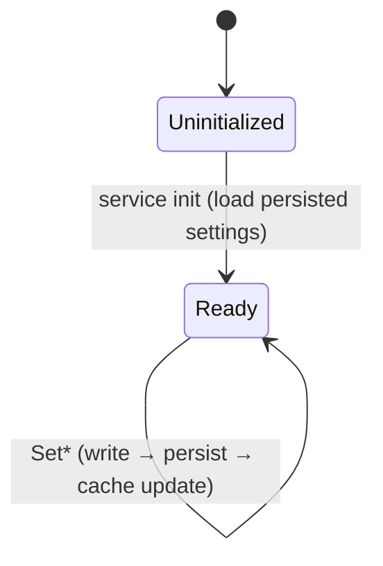

> **Sourcing notice.** Every fact here is drawn from **public interoperability
> references** (SwitchBrew; the open-source Atmosphère / libstratosphere `sf` and
> `set` mitm; LibHac; hactool/nstool documentation). Nothing here is derived from,
> or verified against, the proprietary firmware in the research workspace. Values
> that would need confirmation against the reference firmware are listed in §10
> (Verification Ledger), not asserted. No code, no decompiled excerpts. (RULES.md
> Rule 0 / Rule W.)

## 1. Scope

**In scope** — the behavioral interface surface of the Horizon *Settings* service
that Verdant's **Almanac** module replaces:

- service **`set`** — general settings readable by any process (language, region,
  keyboard key-code map);
- service **`set:sys`** — system settings: the general-purpose **key-value
  settings store**, firmware version reporting, and themed UI (color set);
- the **key-value system settings model** shared by the above.

**Out of scope (deferred to their own slices):**

- **`set:cal`** (factory / calibration settings — device identity, certificates,
  radio addresses, and key material held in calibration storage). This is
  identity- and crypto-sensitive and gets a dedicated slice with careful handling.
- **`set:fd`** (firmware-debug settings) — low priority; noted for completeness.
- Persistence *internals* (the on-storage system-save format). Almanac depends on
  the file system service (Cumulus) for persistence; the save-data format is a
  Cumulus/Rime slice. This paper specifies persistence only *behaviorally*.

## 2. Role in the system

Settings is the system's configuration authority. The OS and applications query it
for the user's language and region, UI theme, device nickname, and a wide range of
named system-configuration values; a smaller set of values can be written. It is a
leaf-ish service: it serves many callers and itself depends mainly on the file
system for persistence.

**Dependencies (behavioral):** service manager `sm` (registration/discovery);
the file system service for reading/writing the persisted system settings;
calibration settings (`set:cal`, out of scope) for a few factory-provisioned
values surfaced read-only.

**Reuse pointer for Development:** Atmosphère already ships an open-source `set`
**mitm** that overlays user-chosen values (e.g. forcing a language or color set,
blanking the serial number) on top of the stock service. It is a strong reference
for the overlay/merge behavior and for the shape of the system-settings INI the
community already uses. (GPL-2.0 — Development reuse, not reference-only.)

## 3. Interface surface

IPC grammar: see **CORE-CMIF-IPC**. Both services below use **CMIF**. Command
tables give **behavioral names and purposes**; exact **numeric command IDs** are
version-specific and are **Verification-Ledger items (O-2)**, not asserted here.

### 3.1 `set` — general settings (readable by any process)

| group | command (behavioral name) | purpose | inputs → outputs |
|---|---|---|---|
| Language | GetAvailableLanguageCodes | list the LanguageCodes this firmware supports | — → array of LanguageCode (§4.1) |
| Language | GetAvailableLanguageCodeCount | count of the above | — → count |
| Language | GetLanguageCode | the active system LanguageCode | — → LanguageCode |
| Language | MakeLanguageCode / ConvertLanguageToLanguageCode | map a Language enum value (§4.2) to its LanguageCode | Language → LanguageCode |
| Region | GetRegionCode | the system RegionCode (§4.3) | — → RegionCode |
| Keyboard | GetKeyCodeMap / GetKeyCodeMap2 | the keyboard key-code map for the active layout | (buffer type B) → map bytes |

Notes: the "available language" set and count **grew across firmware versions**;
the 23.0.x set/count is **LEDGER O-3**. Older/newer command *variants* (e.g. a "2"
suffixed form) reflect version evolution — presence in 23.0.x is **LEDGER O-2**.

### 3.2 `set:sys` — system settings

Behavioral command **groups** (not exhaustive; representative of the public surface):

| group | commands (behavioral) | purpose |
|---|---|---|
| Key-value store | GetSettingsItemValueSize; GetSettingsItemValue | read a named system-settings item by (group-name, item-name) — the general store, §4.4 |
| Firmware version | GetFirmwareVersion; GetFirmwareVersion2 | report the system version structure (§4.5) |
| UI theme | GetColorSetId; SetColorSetId | the basic light/dark color set (§4.6) |
| Device identity (surfaced) | GetDeviceNickName; SetDeviceNickName | the user-set device name (UTF-8) |
| Misc system flags | many getters/setters | assorted booleans/enums/structs in the key-value store, exposed via dedicated commands |

The **general store** (GetSettingsItemValue) is the heart of this service and the
primary thing Almanac must reproduce (§4.4). Many of the "dedicated" getters/
setters are typed accessors over items in that same store.

**Buffers/handles:** value reads use an output buffer (type B); the caller first
asks for the size, then reads. No handles are moved/copied for the commands in
scope. (Confirm per-command buffer descriptor types — **LEDGER O-4**.)

## 4. Data model

Behavioral layouts for interoperability — field tables, never copied bytes.

### 4.1 LanguageCode
Fixed-width **8-byte**, null-padded ASCII string holding a BCP-47-style tag
(e.g. `ja`, `en-US`, `pt-BR`). Trailing bytes are zero.

| offset | size | type | name | meaning |
|---|---|---|---|---|
| 0 | 8 | char[8] | code | null-padded language tag |

### 4.2 Language (enum)
An integer enum selecting a UI language; each value maps 1:1 to a LanguageCode via
MakeLanguageCode. The **ordered value list grew by firmware version**. Known
public members (order/membership to confirm — **LEDGER O-3**): Japanese,
AmericanEnglish, French, German, Italian, Spanish, Chinese, Korean, Dutch,
Portuguese, Russian, Taiwanese, BritishEnglish, CanadianFrench,
LatinAmericanSpanish, SimplifiedChinese, TraditionalChinese, BrazilianPortuguese.

| offset | size | type | name | meaning |
|---|---|---|---|---|
| 0 | 4 | s32 | value | index into the firmware's ordered Language list |

### 4.3 RegionCode (enum)
| value (public) | region |
|---|---|
| 0 | Japan |
| 1 | USA (Americas) |
| 2 | Europe |
| 3 | Australia |
| 4 | China |
| 5 | Korea |
| 6 | Taiwan |

Stored as s32. (Confirm membership for 23.0.x — **LEDGER O-3**.)

### 4.4 System settings item (the key-value model)
An item is addressed by **two UTF-8 strings** — a **group/class name** and an
**item name** — and holds a **typed, variable-size value** (an opaque byte blob
whose interpretation is per-item: bool, integer, enum, fixed struct, or string).

Access pattern (behavioral):
1. caller supplies (group-name, item-name);
2. `GetSettingsItemValueSize` → byte size of the value;
3. caller allocates and calls `GetSettingsItemValue` with an output buffer of at
   least that size → the value bytes (and the actual size).

| element | type | meaning |
|---|---|---|
| group name | UTF-8 string | item namespace/class (e.g. a subsystem name) |
| item name | UTF-8 string | key within the group |
| value | byte blob | per-item typed payload; size from GetSettingsItemValueSize |

The **set of valid (group, item) keys and each one's type/size** is firmware
data. The naming scheme is behaviorally stable; the **exact catalogue for 23.0.x
is LEDGER O-5**. The community `set` INI (Atmosphère) is the practical public map
of commonly-used keys and is the recommended Development starting point.

### 4.5 FirmwareVersion (structure, behavioral)
A fixed-size record returned by GetFirmwareVersion, containing the numeric version
(major/minor/micro), a revision/build field, and human-readable **platform**,
**version string** (e.g. `23.0.1`), and **display title/name** strings. Exact field
offsets/sizes and the total record size are **LEDGER O-6** (publicly described as a
fixed struct with embedded fixed-length strings; reproduce the layout a caller
observes, not any copied content).

### 4.6 ColorSetId (enum)
| value | meaning |
|---|---|
| 0 | BasicWhite (light) |
| 1 | BasicBlack (dark) |

Stored as s32; settable via SetColorSetId.

## 5. Behavior & state

- **Read/write asymmetry.** Most of the surface is read-only to callers; a limited
  set is writable (color set, device nickname, and specific writable items).
- **Persistence.** Writable values persist across reboot via the system settings
  save (owned by the file system service). Behaviorally: a write is durable once
  the command returns success; a subsequent read returns the written value. The
  storage format is a Cumulus/Rime concern, not specified here.
- **Caching.** The service may serve reads from an in-memory cache populated at
  init from persisted settings. Behaviorally the only guarantee a caller relies on
  is read-your-write consistency per §5 persistence. (Confirm whether any item is
  cached-only / volatile — **LEDGER O-7**.)
- **Defaults.** Unset writable items return a firmware default. The default set is
  **LEDGER O-5** (part of the item catalogue).
- **Language/region coupling.** GetLanguageCode reflects the user's current choice
  (settable through system UI, not necessarily through a public `set` command);
  GetAvailableLanguageCodes bounds the valid choices for this firmware.
- No sub-objects / domain hand-offs are required for the commands in scope
  (confirm — **LEDGER O-4**).

## 6. Error behavior

Result codes are `(module, description)` pairs (see CORE-CMIF-IPC §5). Conditions a
Verdant implementation must handle; **exact numeric codes are LEDGER O-8**:

| condition | expected result (behavioral) |
|---|---|
| unknown (group, item) key | a distinct "item not found" failure |
| output buffer smaller than value | a distinct "buffer too small" / size failure (caller is expected to size first via GetSettingsItemValueSize) |
| write to a read-only / nonexistent item | a distinct "not writable / not found" failure |
| malformed language/region value | a distinct "invalid argument" failure |
| success | the all-clear result |

## 7. Acceptance criteria

Mapped to the parity dimensions (PLAN §1). Almanac matches Settings when:

- **Functional:** for every in-scope command, identical outputs for identical
  inputs vs the reference, across the full valid input range (language set, region
  set, the item catalogue).
- **Error:** every §6 condition yields the same result code at the same step.
- **State:** read-your-write holds; defaults match; available-language set matches.
- **Persistent formats:** values written by Almanac are read back correctly by the
  stock service and vice-versa (this is ultimately gated on the Cumulus save
  format; for Almanac-in-isolation, round-trip through the same backing store).
- **Resource/Timing:** within the module's envelope (PLAN P2.4 / PR.7.3); Settings
  is light, so this is not expected to bind.
- **Conditions:** correct behavior when the backing store is empty, partially
  written, or unavailable (graceful failure, not crash).

## 8. Test vectors (synthetic)

Reproducible cases a developer turns into tests. Built from fixtures / a synthetic
settings store (PLAN P0.4.4) — never from research material.

1. **Language round-trip:** store LanguageCode `en-US`; GetLanguageCode → `en-US`
   (8 bytes, null-padded); MakeLanguageCode(AmericanEnglish) → `en-US`.
2. **Available languages:** GetAvailableLanguageCodeCount == length of
   GetAvailableLanguageCodes; every returned code is 8-byte null-padded; the active
   code (test 1) is a member.
3. **Region:** store RegionCode = 2; GetRegionCode → Europe(2).
4. **Color set:** SetColorSetId(1); GetColorSetId → 1; persists across a simulated
   restart of the service against the same store.
5. **KV size-then-read:** for a seeded item (group `test`, item `example`, value =
   4 bytes `01 02 03 04`): GetSettingsItemValueSize → 4; GetSettingsItemValue into a
   4-byte buffer → `01 02 03 04`.
6. **KV unknown key:** GetSettingsItemValueSize(group `test`, item `missing`) →
   "item not found" failure (code per LEDGER O-8).
7. **KV short buffer:** GetSettingsItemValue for the 4-byte item into a 2-byte
   buffer → "buffer too small"/size failure, no partial-success masking.
8. **FirmwareVersion:** GetFirmwareVersion → version string field reads `23.0.1`
   for the reference build (see LEDGER O-1 / O-6).

## 9. Provenance

| area | source | confidence | note |
|---|---|---|---|
| IPC grammar (CMIF, buffers, results) | SwitchBrew; libstratosphere `sf` (public) | High | see CORE-CMIF-IPC |
| `set` / `set:sys` existence & purpose | SwitchBrew; Atmosphère `set` mitm (public) | High | long-standing, stable |
| Command *groups* & behavioral names | SwitchBrew; Atmosphère `set` mitm | Medium-High | names stable; exact IDs version-specific (O-2) |
| LanguageCode format (8-byte, null-padded) | SwitchBrew; LibHac | High | |
| Language enum membership/order | SwitchBrew | Medium | grew by version (O-3) |
| RegionCode values | SwitchBrew | High | membership per 23.0.x to confirm (O-3) |
| ColorSetId values | SwitchBrew; Atmosphère `set` mitm | High | |
| Key-value (group,item)→typed-value model | SwitchBrew; Atmosphère `set` INI | High | item *catalogue* is firmware data (O-5) |
| FirmwareVersion struct shape | SwitchBrew; hactool/nstool docs | Medium | field layout to confirm (O-6) |
| Result-code conditions | SwitchBrew; libstratosphere | Medium | exact numeric codes to confirm (O-8) |
| Persistence/caching behavior | SwitchBrew; Atmosphère | Medium | details are Cumulus-gated (O-7) |

*Confidence is about match to the reference firmware, not about the public
source's reliability. "Medium" means behaviorally verify before relying on it.*

## 10. Verification Ledger

A paper may ship with open items; it may not ship with silent gaps. Each item is
confirmed **behaviorally** against the reference (black-box observation /
differential testing per PLAN P2.5.4), never by transcribing research material.

| id | item | how to confirm | status |
|---|---|---|---|
| O-1 | Reference is 23.0.1; research material is 23.0.0. Do the Settings command set / enums / item catalogue differ between them? | Behavioral diff of `set`/`set:sys` on both; record deltas | open |
| O-2 | Exact numeric command IDs for 23.0.x, and which command *variants* ("2"-suffixed, etc.) are present | Behavioral probing / public version-history cross-check | open |
| O-3 | Exact Language enum membership+order, available-language set/count, RegionCode membership for 23.0.x | GetAvailableLanguageCodes/Count; MakeLanguageCode across the range | open |
| O-4 | Per-command buffer descriptor types; whether any in-scope command hands out sub-objects / needs domains | Behavioral IPC observation (Radar, PLAN P2.5) | open |
| O-5 | The (group, item) catalogue for 23.0.x: valid keys, each one's value type/size and default | Enumerate via the public INI map + behavioral reads | open |
| O-6 | FirmwareVersion record: field offsets/sizes, total size, string field lengths | Behavioral read of the returned structure | open |
| O-7 | Which items (if any) are volatile/cached-only vs persisted | Write-read-restart behavioral test | open |
| O-8 | Exact result codes for: item-not-found, buffer-too-small, not-writable, invalid-argument | Behavioral error probing | open |

---

*Next: boundary review (RULES.md Rule W / PLAN PR.6.4) before status → `ready`.
Then Development may implement Almanac from this paper + CORE-CMIF-IPC, or Research
proceeds to the FS (Cumulus) overview slice.*
